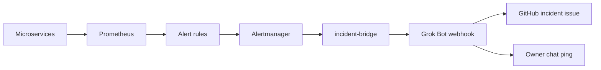

# ResilienceOps — Autonomous Cloud Reliability & Self-Healing Platform

> An SRE lab where Red Team agents inject real infrastructure faults into a live microservices stack, Blue Team agents detect and remediate SLO breaches, and Prometheus alerts are diagnosed by an importable **Grok Bot** template that opens GitHub issues — monitored second-by-second on Grafana.

---

## Overview

Modern distributed systems require continuous resilience validation, yet conventional **chaos engineering** is either purely manual or disconnected from automated remediation workflows. **ResilienceOps** closes this loop with a containerized microservices lab, in-cluster agents, and an external AI incident-diagnosis bot.

The platform runs an authentic containerized stack under live traffic. A coordinated **3-Agent Red Team** analyzes the topology and executes kernel-level and network-level faults (cgroup memory leaks, CPU CFS quota exhaustion, network delays, TCP drops). A **3-Agent Blue Team** watches Golden Signals, declares SLO breaches, runs RCA, executes recovery runbooks, and writes post-mortems. In-cluster model IDs are set in [`agents/config.py`](agents/config.py) (defaults: `claude-sonnet-4-6` and `claude-haiku-4-5-20251001`; override with env vars).

In parallel, Prometheus alerting rules fire into Alertmanager. The **incident-bridge** enriches each alert and POSTs it to the importable Grok Bot template **[AI Incident Diagnosis](https://x.ai/bot/feQpDSeSki7HVgkDCBUaY)**. The bot diagnoses likely root cause from the evidence bundle plus recent commits in the watched GitHub repo, then opens an `incident`-labeled GitHub issue (or comments on an existing one). That path is **read-only**: the bot never restarts, scales, rolls back, or pushes code. Self-healing from the bot is a v2 roadmap item. A labeled synthetic run of that path is in [Sample output: a real test run](#sample-output-a-real-test-run).

All telemetry is streamed in **real time (1-second scrape)** to Grafana.

**This README is the current source of truth** for setup, model IDs, alerting, and the Grok Bot. The [technical documentation PDF](docs/ResilienceOps_Technical_Documentation.pdf) is a historical brief — prefer the README when they disagree. For a dated telemetry snapshot, see [RESULTS.md](RESULTS.md).

---

## Key Features

- **Enterprise Infrastructure & Linux Kernel Execution**:
  - Manipulates raw Linux network interfaces (`eth0`) via **Linux Traffic Control (`tc netem`)** to inject genuine packet queuing delays and random frame drops directly in the container kernel network stack.
  - State persistence and distributed caching tier featuring **Redis 7** and **PostgreSQL 16**.
  - Real connection pool starvation faults exhausting Redis `maxclients` limits, creating authentic connection timeouts.
  - Binary chunks are allocated directly in container heap memory to physically trigger the Linux kernel **cgroup OOMKiller (Exit 137)**.
  - CPU starvation executes real mathematical compute loops triggering **CFS quota throttling**.
- **Balanced 3-vs-3 Multi-Agent Architecture** (model IDs from `agents/config.py`):
  - **Red Team (Offensive Testing Squad)**:
    - *Resilience Attack Planner* (`claude-sonnet-4-6`): Decides which system components to test and designs the overall attack plan.
    - *Server Resource Stresser* (`claude-sonnet-4-6`): Tests server limits by filling memory (RAM), exhausting Redis connection pools, and maxing out CPU compute cores.
    - *Network Delay Injector* (`claude-haiku-4-5-20251001`): Tests network resilience by programming Linux kernel `tc netem` rules to delay or drop packets on `eth0`.
  - **Blue Team (Defensive Recovery Squad)**:
    - *Health & Uptime Monitor* (`claude-haiku-4-5-20251001`): Continuously watches website response times and flags whenever services slow down or fail.
    - *Root Cause Investigator* (`claude-sonnet-4-6`): Investigates errors and pinpoints why things broke.
    - *Automated Recovery Fixer & Report Writer* (`claude-sonnet-4-6`): Executes automated recovery runbooks and generates post-incident reports. Path A writes `reports/incident_*.md`; it does not open GitHub issues.
- **AI Incident Diagnosis (Grok Bot template)**:
  - Import **[AI Incident Diagnosis](https://x.ai/bot/feQpDSeSki7HVgkDCBUaY)**. Alerts flow services → Prometheus rules → Alertmanager → incident-bridge → Grok Bot webhook → GitHub `incident` issue and (for firing critical alerts) an owner chat ping.
  - The bot is read-only. Duplicate fingerprints comment on the open issue; resolved alerts comment when the alert clears.
- **Dual-Pane Observability Separation (Infrastructure vs. Security)**:
  - **Grafana (Pure Infrastructure Monitoring)**: real-time streaming (`refresh: 1s`, `liveNow: true`, default window `now-5m`) displaying Google SRE Golden Signals, Availability SLO % (99.9% dashboard threshold), Latency percentiles (p50, p95, p99), Ingress RPS vs 5XX error area charts, Service traffic shares, and live Microservice Memory Usage plotted against the 256MB cgroup ceiling on order-service and payment-service. Free of audit clutter and emojis.
  - **AWS CloudWatch (Agent Logs & Fault Telemetry)**: Agents best-effort `put_log_events` to `/sre/autonomous-agent-audit` (`agents/common/structured_logger.py`). Helper scripts put dashboards `SRE-Autonomous-Agent-Security-Audit` (`create_cw_dashboard.py`) and `SRE-fault-Vectors-Live-Telemetry` (`test_grafana_proxy.py`). Terraform does **not** create CloudWatch dashboards. Dated screenshots in [RESULTS.md](RESULTS.md) used console names `Agent-Command-Log` and `System-Fault-Metrics`.
- **Kubernetes Agent Sandbox & Security Quarantine**:
  - Agents run inside an isolated `sre-agent-sandbox` namespace constrained by Kubernetes resource limits (`cpu: 500m`, `memory: 512Mi`), audited RBAC roles, and egress NetworkPolicies.
  - Interactive operator shell access via `kubectl exec -it deployment/red-team-sandbox -n sre-agent-sandbox -- /bin/bash` with direct cluster connectivity to microservice targets.
- **Enterprise Cost-Optimized Cloud Deployment**:
  - Single-file Terraform architecture (`terraform/main.tf`) deploying `aws_vpc.sre_vpc` (`sre-enterprise-vpc`, default `10.0.0.0/16`) with internet gateway `sre-enterprise-igw`, a public route table on `public_ingress` only, three subnets (`public_ingress` `10.0.1.0/24` used; `app_workloads` `10.0.10.0/24` and `data_persistence` `10.0.20.0/24` created unused), security groups `ingress_sg` (`sre-ingress-sg`) and `internal_app_sg` (`sre-internal-app-sg`), IAM role + `AmazonSSMManagedInstanceCore` + instance profile, and an EC2 host in `public_ingress` (default `t3.small`; `instance_type` is a variable).
  - Eliminates AWS NAT Gateways (\$32/mo) and EKS control plane fees (\$72/mo).
  - 1-command deploy and 1-command clean teardown ensuring zero orphan charges.

---

## System Architecture

<p align="center">
  
</p>
<p align="center"><b>Figure 1: How ResilienceOps + AI Incident Diagnosis works</b></p>
<p align="center">The bottom cards are Path B (alert → bridge → bot → GitHub). Red/Blue on k3s is Path A. AWS/EC2 is <em>optional</em>: local <code>docker compose up</code> is the same Compose lab, and the Grok bot works in both (the bridge only needs outbound HTTPS to the webhook). On AWS, Compose and k3s run on the <em>single</em> EC2 host in <code>public_ingress</code> (VPC <code>sre-enterprise-vpc</code> + IGW); <code>app_workloads</code> and <code>data_persistence</code> are created but unused. Grafana only <em>reads</em> Prometheus. order-service owns Redis and <code>orders_db</code>. The figure uses one Red arrow (<em>faults</em>) and one Blue arrow (<em>health ×3 / reset</em>); endpoint details (<code>POST /fault/*</code>, <code>tc netem</code>, <code>GET /health</code> on three services, reset) are in the step-by-step below. Claim-to-evidence: <a href="docs/ACCURACY.md"><code>docs/ACCURACY.md</code></a>.</p>
<p align="center">Source: <a href="docs/architecture.svg"><code>docs/architecture.svg</code></a> (rebuild + render with <code>scripts/render_architecture.sh</code> / <code>scripts/build_architecture.py</code>). Companion mermaid: <a href="docs/architecture.mmd"><code>docs/architecture.mmd</code></a>.</p>

### Step-by-step flow (matches the code)

Traffic always runs: compose `traffic-generator` POSTs `api-gw:8000` at `RPS_TARGET` (compose default **20**; `traffic-generator/load_generator.py` defaults to **25** only if you run it on the host with no env). `api-gw` reverse-proxies `/api/orders*` to `order-service:8001` and `/api/payments*` to `payment-service:8002`. Order-service writes Redis + PostgreSQL and POSTs `/payments`. Prometheus (`dashboards/prometheus.yml`) scrapes `/metrics` every **1s** from those three jobs and evaluates `dashboards/alerts.yml`. Grafana (`:3000`) is a PromQL dashboard only — it is **not** on the alert path. Prometheus is published as `127.0.0.1:9090` only.

After a fault, **two code paths** run. Path A is `orchestrator.py`. Path B is Prometheus → Alertmanager → incident-bridge → Grok Bot. Stages below are what the code actually does.

1. **Fault injection** (`orchestrator.py` phases 2–3) — `faultStrategistAgent.plan_campaign` then either `InfraDisruptorAgent.execute_fault` (order-service `POST /fault/leak-memory`, `/fault/redis-starvation`, `/fault/cpu-burn`, `/fault/crash`) or `NetworkAdversaryAgent.execute_fault` (payment-service `tc netem` via `/fault/latency` or `/fault/drop-rate`). `--scenario` strings the CLI documents: `MEMORY_EXHAUSTION`, `REDIS_CONNECTION_STARVATION`, `CPU_SATURATION`, `NETWORK_LATENCY`, `PACKET_LOSS`. Dispatch is substring-based: `NETWORK` / `PACKET` / `LATENCY` → network agent; `REDIS` / `CPU` / `CRASH` → infra agent; anything else → memory leak. The catalog records network faults as `KERNEL_TC_NETEM_LATENCY` / `KERNEL_TC_NETEM_PACKET_LOSS` (those names also work as `--scenario` because they contain `LATENCY` / `PACKET`).
2. **Detection** (phase 4, in parallel with Prometheus) — `IncidentMonitor.inspect_telemetry` `GET`s `/health` on api-gw (4s timeout), order-service, and payment-service. If `PROMETHEUS_URL` answers, it also queries p99 of `http_request_duration_seconds` and the 5xx share of `http_requests_total`. `evaluate_slos` declares an incident when p99/probe latency > `SLO_MAX_P99_LATENCY_MS` (1200), error rate > `SLO_MAX_ERROR_RATE_PERCENT` (2), or a service returns HTTP >= 500. The loop is at most **9 ticks of 1s** (`for tick in range(1, 10)`). Prometheus evaluates the same SLO/infra/payment rules in `dashboards/alerts.yml` every 1s independently of the orchestrator.
3. **Alert** — when a rule stays true for its `for:` window, Prometheus sends it to Alertmanager at compose DNS `alertmanager:9093` (`dashboards/prometheus.yml`). Alertmanager is published on the host as `127.0.0.1:9093`. Alertmanager groups (`group_wait: 5s`, `group_interval: 15s`, `repeat_interval: 1h`) and POSTs to `http://incident-bridge:8080/webhook` with `send_resolved: true`.
4. **Enrichment** — `incident-bridge` (`services/incident-bridge/app.py`) builds an evidence bundle (PromQL range summaries for `EVIDENCE_WINDOW_SECONDS` default 600, tailed `AGENT_ACTIVITY_LOG`, optional k8s events), caps the payload at `PAYLOAD_MAX_BYTES` (~100KB), and POSTs `{status, alerts, evidence, source: "resilienceops"}` using `GROK_WEBHOOK_*`. Same `fingerprint`+`status` is forwarded at most once per `DEDUPE_TTL_SECONDS` (300). If `GROK_WEBHOOK_URL` is empty, the bridge logs `GROK_WEBHOOK_URL is unset; dropping alert payload` and returns `"dropped_unconfigured"` — the rest of the lab keeps running. If the outbound POST fails after `WEBHOOK_MAX_RETRIES`, the bridge logs `forward FAILED after N attempts alertname=… fingerprint=…`, writes `logs/bridge_deadletter.jsonl` (no key), queues a bounded in-memory retry, and does **not** crash the ASGI app. The webhook key is never logged. **`agent_activity` is empty unless something is writing `logs/agent_activity.jsonl`** — that is the opt-in `agents` Compose profile or a host `orchestrator.py` run, not the default `docker compose up`.
5. **Diagnosis** — Path A: `DiagnosticAgent.analyze` uses telemetry plus optional k8s events and `EnterpriseLLMEngine` (`MODEL_DIAGNOSTIC_RCA`, default `claude-sonnet-4-6`) to pick a root cause and runbook (e.g. `MEMORY_EXHAUSTION_OOM` → `EVICT_CONTAINER_AND_PURGE_LEAK`). Path B: the imported Grok Bot template **AI Incident Diagnosis** diagnoses from the evidence bundle **plus recent commits** in the watched GitHub repo. The bot is read-only (no restart/scale/rollback/push).
6. **Issue** — the Grok Bot opens a GitHub issue labeled `incident`. If an issue for that fingerprint is already open, it **comments** there instead of opening a duplicate. Firing **critical** alerts also chat-ping the owner (per the ping preference set at import). Path A does not open GitHub issues; it writes `reports/incident_*.md` after remediation.
7. **Resolution** — Path A: `RemediatorAgent.execute_runbook` always calls `FaultCatalog.reset_environment()` (`POST /fault/reset` on order-service and payment-service) and may restart/scale via k8s if the toolkit is available. `verify_recovery` GETs api-gw `/health` up to **5** times; success is HTTP 200 and probe latency **< 800ms**. `PostMortemGenerator.generate` writes `reports/incident_*.md`. StructuredLogger appends `logs/agent_activity.jsonl` and best-effort CloudWatch. Path B: when the PromQL rule clears, Alertmanager sends `status: resolved`. The bridge forwards it (resolved is a different status, so the 5-minute dedupe does not drop it). The bot comments on the GitHub issue. The bot does not reset the fault.



---

## Kubernetes Agent Sandbox Architecture & Security Quarantine

To ensure completely safe autonomous operations in production, all offensive testing and defensive recovery agents execute inside a dedicated, isolated Kubernetes sandbox container (`sre-agent-sandbox` namespace). Operators trigger resilience campaigns remotely, while the sandbox enforces strict hardware limits, least-privilege API permissions, and granular network filtering.

<p align="center">
  
</p>
<p align="center"><b>Figure 2: Kubernetes Agent Sandbox Pod Architecture, Resource Limits & Egress Network Rules</b></p>

### What Purpose Does the Agent Sandbox Solve?

Deploying autonomous AI agents directly onto host systems creates severe reliability and security risks: runaway script loops could exhaust server compute, faulty remediation logic could disrupt system daemons, and unmonitored network sockets could probe unintended services.

The **Kubernetes Agent Sandbox** provides a zero-blast-radius containment boundary with 3 core security pillars:

| Security Pillar | Concrete Enforcement Mechanism | SRE & Platform Protection Guarantee |
|:---|:---|:---|
| **1. Agent Resource Limits (CPU / RAM)** | Hard cgroup limits enforced per pod: `0.5 CPU (500m)` and `512 MiB RAM`. | If an agent experiences a runaway loop or memory leak, the Linux kernel cgroup OOMKiller immediately terminates the sandbox container (`Exit 137`). **Host node stability and system daemons are 100% protected**. Importantly, sandbox resource constraints cap agent compute—they do not limit or dampen the authentic fault impact injected into target microservices. |
| **2. API Permissions (ServiceAccount + RBAC)** | Namespaced Roles on `sre-target-apps` only (no ClusterRole). Red Team (`k8s/agents/agent-sandbox.yaml`): `get`/`list`/`watch` on `pods` and `pods/exec`. Blue Team (`k8s/base/namespace-rbac.yaml`): `get`/`list`/`watch`/`delete` on pods, `get` on `pods/log`, `get`/`list` on events, and `get`/`list`/`watch`/`patch`/`update` on `deployments` / `deployments/scale`. | Agents have **no cluster-admin**. They cannot inspect `kube-system` or cluster secrets through these Roles. `kubectl exec` into the sandbox from the host uses the operator kubeconfig, not the sandbox ServiceAccount. |
| **3. Network Rules (Egress Policies)** | Declarative `NetworkPolicy` controlling pod ingress and egress traffic. | Egress allows DNS (`TCP/UDP 53`), pods in namespaces labeled `arena.sre.io/role=victim` (`sre-target-apps`), and outbound TCP `443` (Anthropic and AWS APIs; default k3s/flannel cannot FQDN-filter). The Grok Bot webhook is sent by **incident-bridge** on the Compose network, not by the sandbox NetworkPolicy. |

### How the Sandbox Operates During Incident Cycles

1. **Operator Trigger**: An SRE engineer launches a resilience test cycle remotely via `kubectl exec` into the sandbox pod (`python3 orchestrator.py`).
2. **Sandbox Pod Execution**:
   - **Red Team Agents**: Select and trigger surgical faults against target services (e.g., cgroup memory leaks on `order-service`, Linux kernel `tc netem` latency on `payment-service`).
   - **Blue Team Agents**: Continuously monitor golden signals, check service health, invoke the configured diagnostic model over outbound HTTPS (port 443) for root-cause analysis, and execute automated runbook resets.
3. **Target Services Tier**: The live microservices cluster (`Order`, `Payment`, `API Gateway`) receives the injected faults and resets while keeping underlying host OS and cluster system pods completely isolated.

---

## Tech Stack

| Domain | Technology / Tool | Version | Purpose |
|---|---|---|---|
| **AI Frontier Models** | Anthropic Claude Sonnet 4.6 | `claude-sonnet-4-6` (from `agents/config.py`) | Attack planning, RCA, auto-remediation, post-mortems |
| | Anthropic Claude Haiku 4.5 | `claude-haiku-4-5-20251001` | Incident monitoring and network-adversary actions |
| | Grok Bot template | [AI Incident Diagnosis](https://x.ai/bot/feQpDSeSki7HVgkDCBUaY) | Read-only alert diagnosis, GitHub `incident` issues, critical chat pings |
| **Backend / Services** | Python / FastAPI / Uvicorn | `3.11` / `0.111.0` | High-throughput asynchronous target microservices & API Gateway |
| | HTTPX | `0.27.0` | Asynchronous inter-service HTTP client and proxy router |
| | Pydantic | `2.8.2` | Data validation and JSON schema enforcement |
| **Observability** | Prometheus | `v2.52.0` | 1-second high-resolution metric collection, PromQL engine, and alerting rules |
| | Alertmanager | `v0.27.0` | Groups SLO/infra alerts and posts them to the incident bridge (localhost only) |
| | Incident Bridge | FastAPI | Enriches alerts with Prometheus/log evidence and forwards them to an AI diagnosis webhook |
| | Grafana | `10.4.2` | Pure infrastructure monitoring dashboard (:3000) |
| | AWS CloudWatch | Native AWS | Dedicated security audit dashboard tracking exact agent commands and outputs |
| **Load Testing** | Python async worker (`traffic-generator`) | Compose `RPS_TARGET` default 20 | Concurrent multi-step consumer workflow against `api-gw` |
| **Container & Cloud** | Docker & Docker Compose | Compose v2 | Container runtime, resource isolation, and local orchestration |
| | k3s | Installed by EC2 `user_data` (`https://get.k3s.io`) | Lightweight Kubernetes for the agent sandbox on AWS |
| | Terraform | `>= 1.5.0` (`terraform/main.tf`) | All-in-one Infrastructure-as-Code for AWS cloud deployment |
| | AWS (VPC `sre-enterprise-vpc`, subnets, `ingress_sg` / `internal_app_sg`, EC2, IAM, SSM, CloudWatch) | Provider `~> 5.0` | Multi-tier cloud infrastructure host with zero NAT Gateway overhead |

---

## Installation and quick start

Follow these steps in order: **local lab first** (clone, `.env`, Docker Compose, Grok Bot), then AWS + k3s if you want the cloud host (steps 8–10). After Terraform and the sandbox are up, use [Operating the lab on AWS](#operating-the-lab-on-aws) for Grafana, CloudWatch, `orchestrator.py` cycles, and teardown. Skip that section if you are only running Compose on your laptop.

### Local or AWS?

AWS/EC2 is **optional**. `docker compose up` on a laptop is the same Compose lab (api-gw, order/payment, Prometheus, Alertmanager, incident-bridge, Grafana). The Grok bot works in both places: the incident-bridge only needs **outbound HTTPS** to the webhook (`GROK_WEBHOOK_URL`). Steps 8–10 add VPC `sre-enterprise-vpc` and a **single** EC2 host in `public_ingress`; Compose and k3s run on that instance. Terraform also creates `app_workloads` and `data_persistence`, but nothing is deployed there today.

### 1. Prerequisites

- **Git**, **Python 3.10+**, and **Docker** with Docker Compose v2 (`docker compose version`).
- Commands below use **`python3`**. Ubuntu/Debian typically have no `python` alias; if `python3` is missing, install it (`sudo apt-get install python3 python3-pip`).
- **Anthropic API key** for the in-cluster Red/Blue agents (models listed in `agents/config.py`).
- **Grok Bot** access to import the [AI Incident Diagnosis](https://x.ai/bot/feQpDSeSki7HVgkDCBUaY) template (GitHub must be connected to the bot).
- For AWS: **AWS CLI** (`aws sts get-caller-identity`) and **Terraform 1.5+**.
- Regenerating the architecture PNG: `librsvg2-bin` (`rsvg-convert`) or Google Chrome; then `./scripts/render_architecture.sh`.

### 2. Clone the repository

```bash
git clone https://github.com/ritvikindupuri/ResilienceOps.git
cd ResilienceOps
```

### 3. Create `.env` from `.env.example`

```bash
# On Linux / macOS / Git Bash:
cp .env.example .env

# On Windows PowerShell:
Copy-Item .env.example .env
```

Edit `.env`. There is **no** default Grafana password. **`GRAFANA_ADMIN_USER` and `GRAFANA_ADMIN_PASSWORD` must be non-empty** before any compose command: the compose file uses `${GRAFANA_ADMIN_USER:?Set GRAFANA_ADMIN_USER}` and interpolation fails otherwise. Do not commit `.env` (see [SECURITY.md](SECURITY.md)).

Every `os.getenv` / `_env_int` / `_env_float` name in the Python tree is listed in [`.env.example`](.env.example). Compose interpolates Grafana, Postgres, Grok webhook, bridge tunables, `RPS_TARGET` / `CONCURRENCY`, agent-sandbox `ANTHROPIC_API_KEY`, and SLO thresholds from the same file.

| Variable | Used by | Notes |
|---|---|---|
| `GRAFANA_ADMIN_USER` | compose Grafana | **Required.** Empty → `docker compose config` exits non-zero: `GRAFANA_ADMIN_USER: Set GRAFANA_ADMIN_USER` |
| `GRAFANA_ADMIN_PASSWORD` | compose Grafana | **Required.** No `admin`/`admin` default |
| `ANTHROPIC_API_KEY` | `agents/common/llm_engine.py`, compose `agent-sandbox` | Required for in-cluster Claude calls. Compose uses `${ANTHROPIC_API_KEY:-}` so an empty value still starts the sandbox |
| `POSTGRES_PASSWORD` | compose postgres + order-service | `${POSTGRES_PASSWORD:-sre_password}` |
| `EC2_INSTANCE_ID` | `agents.config.require_ec2_instance_id`, `deploy_remote.py` | Required before remote deploy; no default |
| `SRE_EC2_INSTANCE_ID` | same helper | Alias for `EC2_INSTANCE_ID` |
| `AWS_REGION` | `agents/config.py` | Default `us-east-1` |
| `GROK_WEBHOOK_URL` | incident-bridge | Empty = drop alerts locally (`webhook_configured: false`) |
| `GROK_WEBHOOK_KEY` | incident-bridge | Never logged; copy from the routine in the bot info pane |
| `GROK_WEBHOOK_AUTH_HEADER` | incident-bridge | Default `Authorization`; must match the panel |
| `GROK_WEBHOOK_AUTH_SCHEME` | incident-bridge | Default `Bearer`. Compose uses `${GROK_WEBHOOK_AUTH_SCHEME-Bearer}` so a present-but-empty value sends the raw key |
| `API_GATEWAY_URL` | `agents/config.py` | Host default `http://localhost:8000`. Compose sandbox sets `http://api-gw:8000` |
| `ORDER_SERVICE_URL` | `agents/config.py`, order/payment clients | Host default `http://localhost:8001` |
| `PAYMENT_SERVICE_URL` | `agents/config.py`, api-gw, order-service | Host default `http://localhost:8002` |
| `PROMETHEUS_URL` | `agents/config.py`, incident-bridge | Host default `http://localhost:9090`. Bridge container uses `BRIDGE_PROMETHEUS_URL` |
| `BRIDGE_PROMETHEUS_URL` | compose → bridge `PROMETHEUS_URL` | Default `http://prometheus:9090` (compose DNS) |
| `LOGS_DIR` | `agents/config.py` | Default `logs` |
| `AGENT_ACTIVITY_LOG` | incident-bridge | Compose hardcodes `/app/logs/agent_activity.jsonl` (the `./logs` volume). Host default in `.env.example` is `logs/agent_activity.jsonl` |
| `EVIDENCE_WINDOW_SECONDS` | incident-bridge | Default `600` |
| `PAYLOAD_MAX_BYTES` | incident-bridge | Default `102400` |
| `DEDUPE_TTL_SECONDS` | incident-bridge | Default `300` |
| `WEBHOOK_TIMEOUT_SECONDS` | incident-bridge | Default `10` |
| `WEBHOOK_MAX_RETRIES` | incident-bridge | Default `3` |
| `LOG_TAIL_LINES` | incident-bridge | Default `40` |
| `K8S_EVIDENCE_ENABLED` | incident-bridge | Default `true`; `0`/`false`/`no` disables |
| `SLO_MAX_P99_LATENCY_MS` | `agents/config.py`, compose `agent-sandbox` | Default `1200.0` (must match `dashboards/alerts.yml` `> 1.2`) |
| `SLO_MAX_ERROR_RATE_PERCENT` | `agents/config.py`, compose `agent-sandbox` | Default `2.0` |
| `MODEL_fault_STRATEGIST` | `agents/config.py` | Default `claude-sonnet-4-6` (name is spelled this way in code) |
| `MODEL_INFRA_DISRUPTOR` | `agents/config.py` | Default `claude-sonnet-4-6` |
| `MODEL_NETWORK_ADVERSARY` | `agents/config.py` | Default `claude-haiku-4-5-20251001` |
| `MODEL_INCIDENT_MONITOR` | `agents/config.py` | Default `claude-haiku-4-5-20251001` |
| `MODEL_DIAGNOSTIC_RCA` | `agents/config.py` | Default `claude-sonnet-4-6` |
| `MODEL_AUTO_REMEDIATOR` | `agents/config.py` | Default `claude-sonnet-4-6` |
| `MODEL_POST_MORTEM` | `agents/config.py` | Default `claude-sonnet-4-6` |
| `DEFAULT_MODEL` | `agents/config.py` | Default = `MODEL_DIAGNOSTIC_RCA` |
| `AI_PROVIDER` | `agents/config.py` | Default `anthropic` |
| `GEMINI_API_KEY` | `agents/config.py` | Unused by default; kept so `arena_runner` imports |
| `OPENAI_API_KEY` | `agents/config.py` | Unused by default; kept so `arena_runner` imports |
| `CW_LOG_GROUP_ATTACKER` | `agents/config.py` | Default `/sre/autonomous-agent-audit` |
| `CW_LOG_GROUP_DEFENDER` | `agents/config.py` | Default `/sre/autonomous-agent-audit` |
| `CW_LOG_GROUP_INCIDENTS` | `agents/config.py` | Default `/sre/autonomous-agent-incidents` |
| `GATEWAY_URL` | `traffic-generator/load_generator.py`; fallback in `structured_logger.py` | Compose hardcodes `http://api-gw:8000` inside the generator container |
| `RPS_TARGET` | traffic-generator | Compose default **20**. Module default is **25** if unset |
| `CONCURRENCY` | traffic-generator | Compose default **8**. Module default is **10** if unset |
| `REDIS_HOST` / `REDIS_PORT` | order-service | Compose sets `redis` / `6379` |
| `POSTGRES_HOST` / `POSTGRES_PORT` / `POSTGRES_USER` / `POSTGRES_DB` | order-service | Compose sets `postgres` / `5432` / `sre_user` / `orders_db` |

Terraform ingress is **not** an env var. Copy `terraform/terraform.tfvars.example` to `terraform/terraform.tfvars` and set `allowed_cidr` to your `/32` or office CIDR. `0.0.0.0/0` is rejected.

`orchestrator.py` loads `.env` via `python-dotenv` in `agents/common/llm_engine.py` (`load_dotenv()` does not override variables already in the process environment). Compose interpolates `.env` itself.

### 4. Install Python dependencies (host agents / tests only)

Skip this step if you are only running the Compose lab. Service images install their own packages at build time.

Install on the host when you want `python3 orchestrator.py`, `pytest`, or `scripts/send_test_alert.py`:

```bash
python3 -m pip install -r requirements.txt
python3 -m pip install -r services/incident-bridge/requirements.txt
```

`requirements.txt` covers host-side agents, pytest, and `scripts/send_test_alert.py` (`httpx`). The bridge file adds FastAPI/Uvicorn if you run the bridge **without** Compose.

### 5. Import the Grok Bot template and copy webhook credentials

1. Import **[AI Incident Diagnosis](https://x.ai/bot/feQpDSeSki7HVgkDCBUaY)**.
2. The bot's first conversation asks for the **GitHub repo** to file incidents in (GitHub must already be connected), the **alert source**, and the **ping preference**.
3. Open the bot's chat. Click the bot's name in the chat header (or press **Cmd+Shift+I**) to open its info pane.
4. Under **Routines**, open **ResilienceOps incident diagnosis** (or whatever routine the template created).
5. Copy **Webhook URL** into `GROK_WEBHOOK_URL` and **Webhook key** into `GROK_WEBHOOK_KEY`. Check the **Authorization** header setting — that maps to `GROK_WEBHOOK_AUTH_HEADER` / `GROK_WEBHOOK_AUTH_SCHEME` (scheme may be empty).

<!-- screenshot: bot chat header → info pane → Routines → ResilienceOps incident diagnosis (Webhook URL, Webhook key, Authorization) -->

Details: [AI incident diagnosis](#ai-incident-diagnosis).

### 6. Start the local Docker Compose lab

Grafana, Alertmanager, and the incident-bridge are part of this stack. Alertmanager (`127.0.0.1:9093`) and the bridge (`127.0.0.1:8088`) are localhost-only.

Validate interpolation (this **fails** if Grafana admin vars are still empty):

```bash
docker compose config >/dev/null
```

Expected: no output, exit 0. If you skipped Grafana vars, Compose exits non-zero and prints:

```text
error while interpolating services.grafana.environment.[]: required variable GRAFANA_ADMIN_USER is missing a value: Set GRAFANA_ADMIN_USER
```

```bash
docker compose up --build -d
```

Wait until `docker compose ps` shows `incident-bridge` as running (first build compiles the FastAPI images plus Redis, Postgres, Prometheus, Alertmanager, Grafana, and traffic-generator). Compose `healthcheck`s plus `depends_on: condition: service_healthy` gate postgres/redis, the three app services (`order-service` uses `/ready` so Postgres is actually connected), Prometheus, Alertmanager, the bridge, and Grafana. A warning `Docker Compose is configured to build using Bake, but buildx isn't installed` is harmless — Compose falls back to the classic builder.

On AWS after install steps 8–10, Grafana and sandbox cycles are in [Operating the lab on AWS](#operating-the-lab-on-aws).

`agent-sandbox` is **opt-in**. Its image `CMD` is `python orchestrator.py --cycles 5 --delay 10`, which injects real faults. It does **not** start on a plain `docker compose up`. To include it (needs `ANTHROPIC_API_KEY`):

```bash
docker compose --profile agents up -d --build agent-sandbox
```

Then:

```bash
curl -sS http://127.0.0.1:8088/healthz
```

Expected JSON when `GROK_WEBHOOK_URL` is still empty:

```json
{"status":"ok","webhook_configured":false}
```

After you set `GROK_WEBHOOK_URL`, recreate the bridge (`docker compose up -d incident-bridge`) and expect `"webhook_configured":true`.

Optional local agent cycle on the host (needs `ANTHROPIC_API_KEY` in `.env`; `llm_engine.py` calls `load_dotenv()`), instead of the compose profile:

```bash
python3 orchestrator.py --cycles 1 --scenario MEMORY_EXHAUSTION
```

### 7. Confirm the bot path (fault injection is optional)

Injecting a fault is **optional and only for testing**. In real use, real failures trip the Prometheus alert rules; the incident-bridge and Grok bot run the same way whether the alert came from a live outage or from a test.

Three ways to prove the path:

**Quick check** — post a synthetic alert with `scripts/send_test_alert.py`. No `/fault` endpoints, no Red Team.

```bash
python3 scripts/send_test_alert.py --target alertmanager
```

Expected from Alertmanager: HTTP 200 with an empty body. The script prints:

```text
200
```

That only means Alertmanager **accepted** the alert. Confirm the bridge received it:

```bash
docker compose logs --tail 20 incident-bridge
```

- If `GROK_WEBHOOK_URL` is empty you will see `GROK_WEBHOOK_URL is unset; dropping alert payload`.
- If the URL is set you will see `forwarded N alert(s) status=firing source=resilienceops`, then a GitHub `incident` issue in the repo you configured with the bot (or a comment on an existing fingerprint).
- If Alertmanager logs `Notify for alerts failed ... context deadline exceeded`, container-to-container traffic on the compose network is blocked. See [Containers cannot reach each other](#containers-cannot-reach-each-other). Use `--target bridge` (host `127.0.0.1:8088`) to prove the bridge itself.

Equivalent curl **to Alertmanager** (same as `--target alertmanager`):

```bash
curl -sS -H 'Content-Type: application/json' \
  -d '[{"labels":{"alertname":"SyntheticTestAlert","severity":"warning","service":"api-gw"},"annotations":{"summary":"Synthetic test alert"},"startsAt":"'"$(date -u +%Y-%m-%dT%H:%M:%SZ)"'"}]' \
  http://127.0.0.1:9093/api/v2/alerts
```

If the stack is not running, the script prints `request failed: ConnectError` (or `ConnectTimeout`) on stderr and exits 1. Use `--target bridge` to POST `http://127.0.0.1:8088/webhook` directly; expected:

```text
200 {"accepted":true}
```

Equivalent curl **to the bridge** (same as `--target bridge`):

```bash
curl -sS -H 'Content-Type: application/json' \
  -d '{"status":"firing","alerts":[{"status":"firing","labels":{"alertname":"SyntheticTestAlert","severity":"warning","service":"api-gw"},"annotations":{"summary":"Synthetic test alert"},"fingerprint":"synthetic-test"}]}' \
  http://127.0.0.1:8088/webhook
```

A recorded **synthetic** payload against the live bot (GitHub [issue #4](https://github.com/ritvikindupuri/ResilienceOps/issues/4)) is demoted under [Sample output](#sample-output-a-real-test-run). The primary sample is a real `/fault` run that opened [issue #5](https://github.com/ritvikindupuri/ResilienceOps/issues/5).

**Full demo: trip a real alert** — optional. This is a test harness, not how production incidents start. Order-service must already be up (`curl -sS http://127.0.0.1:8001/ready`). Prometheus is host-local at `127.0.0.1:9090`.

```bash
curl -sS -X POST 'http://127.0.0.1:8001/fault/redis-starvation'
# Watch the rule: RedisConnectionSaturation (critical, order-service, for: 5s, threshold >= 48).
# Open http://127.0.0.1:9090/alerts (needs the stack on this host; AWS publishes Prometheus only via SSM).
```

On the 2026-10-19 live run, fault → webhook **200** took about **12 seconds**, and [issue #5](https://github.com/ritvikindupuri/ResilienceOps/issues/5) appeared about **61 seconds** after firing. Then reset:

```bash
curl -sS -X POST 'http://127.0.0.1:8001/fault/reset'
curl -sS -X POST 'http://127.0.0.1:8002/fault/reset'
```

Alertmanager forwards `status: resolved` (`send_resolved: true`). The bot comments on the same issue; it does not reset the fault. Other order-service faults: `POST /fault/leak-memory`, `/fault/cpu-burn`, `/fault/crash`. Payment-service: `/fault/latency`, `/fault/drop-rate` (`tc netem`). Or `python3 orchestrator.py --cycles 1 --scenario REDIS_CONNECTION_STARVATION` (see the [step-by-step flow](#step-by-step-flow-matches-the-code)).

Stop the lab with `docker compose down -v`.

### 8. Deploy AWS infrastructure (Terraform)

```bash
cd terraform
cp terraform.tfvars.example terraform.tfvars   # set allowed_cidr to YOUR /32 or office CIDR
terraform init
terraform apply
```

`terraform/main.tf` creates a dedicated VPC `aws_vpc.sre_vpc` (Name `sre-enterprise-vpc`, CIDR `var.vpc_cidr` default `10.0.0.0/16`) with an internet gateway (`sre-enterprise-igw`), three subnets, a public route table associated only with `public_ingress`, two security groups, an IAM role + `AmazonSSMManagedInstanceCore` + instance profile, and the EC2 host in `public_ingress`:

| Resource | Terraform name | AWS Name / CIDR | What runs there |
| --- | --- | --- | --- |
| VPC | `aws_vpc.sre_vpc` | `sre-enterprise-vpc` `10.0.0.0/16` | Boundary for every AWS resource below |
| IGW | `aws_internet_gateway.igw` | `sre-enterprise-igw` | Default route for the public route table |
| Public RT | `aws_route_table.public_rt` | `sre-public-route-table` | `0.0.0.0/0` via IGW; associated only with `public_ingress` |
| Public subnet | `aws_subnet.public_ingress` | `sre-subnet-public-ingress` `10.0.1.0/24` | **Used:** EC2 host (`map_public_ip_on_launch`) |
| App subnet | `aws_subnet.app_workloads` | `sre-subnet-app-workloads` `10.0.10.0/24` | Created; nothing is deployed into it |
| Data subnet | `aws_subnet.data_persistence` | `sre-subnet-data-persistence` `10.0.20.0/24` | Created; nothing is deployed into it |
| Ingress SG | `aws_security_group.ingress_sg` | `sre-ingress-sg` | Grafana `3000` and API `8000` from `allowed_cidr` |
| Internal SG | `aws_security_group.internal_app_sg` | `sre-internal-app-sg` | `8001–8002` from `ingress_sg`; self scrape |
| IAM | `aws_iam_role.sre_host_role` + SSM attach + instance profile | `sre-platform-host-role` | `AmazonSSMManagedInstanceCore`; no SSH/22 |
| Host | `aws_instance.sre_host` | `sre-enterprise-platform-host` | Compose + k3s via `user_data`; both SGs attached |

Grafana (`3000`) and the API gateway (`8000`) are limited to `allowed_cidr`. Prometheus (`9090`) and SSH (`22`) are **not** opened — use AWS Systems Manager for host access and SSM port forwarding for Prometheus (`127.0.0.1:9090`). The architecture figure shows the VPC group, IGW marker, `public_ingress` around the single EC2 host (Compose + k3s), SG + IAM/SSM markers, and captions for the unused `app_workloads` / `data_persistence` CIDRs.

Typical outputs:

```text
api_gateway_url = "http://54.xxx.xxx.xxx:8000"
grafana_url     = "http://54.xxx.xxx.xxx:3000"
prometheus_url  = "http://127.0.0.1:9090 (host-local; AWS SSM port forwarding)"
public_ip       = "54.xxx.xxx.xxx"
```

Save `public_ip` / `grafana_url`. Put the instance id in `.env` as `EC2_INSTANCE_ID`.

<p align="center">
  
</p>
<p align="center"><b>Figure 3: Dated AWS console resource map of <code>sre-enterprise-vpc</code></b></p>
<p align="center">Console chrome may show a different subnet count than Terraform. <code>terraform/main.tf</code> creates exactly three subnets: only <code>public_ingress</code> is used. Prefer the table above when this screenshot disagrees.</p>

### 9. Push the app to the host (`deploy_remote.py`)

`deploy_remote.py` builds a payload zip from the current tree (compose services, dashboards, agents, incident-bridge) **without** `.env`, then sends it with AWS SSM.

```bash
export EC2_INSTANCE_ID=i-xxxxxxxxxxxxxxxxx
export AWS_REGION=us-east-1
# On the host, set ANTHROPIC_API_KEY, GRAFANA_ADMIN_*, POSTGRES_PASSWORD,
# and GROK_WEBHOOK_* via SSM Parameter Store, Secrets Manager, or instance env.
python3 deploy_remote.py
```

### 10. k3s agent sandbox

Red and Blue agents run in `sre-agent-sandbox` on the AWS host (`500m` CPU, `512Mi` RAM, egress NetworkPolicy).

Connect with SSM (no SSH / port 22):

```bash
aws ssm start-session --target "$EC2_INSTANCE_ID"
```

Or: AWS Systems Manager → Fleet Manager → instance `sre-enterprise-platform-host` → Start terminal session.

On the host:

```bash
k3s kubectl get pods,roles,rolebindings,networkpolicies -n sre-agent-sandbox
k3s kubectl logs -f deployment/red-team-sandbox -n sre-agent-sandbox
k3s kubectl exec -it deployment/red-team-sandbox -n sre-agent-sandbox -- /bin/bash
```

Example cycle:

```bash
k3s kubectl exec -it deployment/red-team-sandbox -n sre-agent-sandbox -- \
  python3 orchestrator.py --target-ip api-gw.sre-target-apps.svc.cluster.local --cycles 1 --scenario MEMORY_EXHAUSTION
```

---


## Operating the lab on AWS

Do [Installation and quick start](#installation-and-quick-start) first. Local Compose (including Alertmanager, incident-bridge, and Grafana on `:3000`) is steps 3–7 of that section. This walkthrough assumes the AWS host and `sre-agent-sandbox` are already deployed and you want to watch Grafana, CloudWatch, and in-cluster cycles.

> [!TIP]
> **Dashboard screenshots**:  
> For high-resolution Grafana/CloudWatch captures and a **dated** telemetry snapshot, see [**RESULTS.md**](RESULTS.md). Some reports quoted there still use the pre-fix `UNKNOWN_FAULT` title; the current generator is [`reports/example_incident_memory_exhaustion.md`](reports/example_incident_memory_exhaustion.md).

### Step 1: Open the Live AWS Grafana Dashboard (Pure Infra Monitoring)
1. Open your web browser and navigate to your AWS Grafana URL:
   ```text
   http://<YOUR_AWS_PUBLIC_IP>:3000
   ```
2. Sign in with the Grafana admin user and password you set in `GRAFANA_ADMIN_USER` / `GRAFANA_ADMIN_PASSWORD`. There is no default `admin`/`admin` password.
3. In the left navigation menu, click **Dashboards** -> **SRE & Reliability** -> click **SRE Infrastructure & Reliability Performance Monitor**.
4. Observe the 8 focused operational panels streaming every **1 second**:
   - **Real-Time Availability SLO %**: High-precision gauge (Target: 99.9%).
   - **Live Request Throughput (RPS)**: Real-time traffic volume (~20-80 RPS).
   - **Live HTTP 5XX Error Rate %**: Tracks server degradation with color-coded thresholds.
   - **Real-Time System State**: Clean high-contrast indicator (`HEALTHY` or `ACTIVE INCIDENT`).
   - **Real-Time Latency Profiles (p50, p95, p99)**: Live latency curves.
   - **Live Ingress RPS vs 5XX Server Errors**: Direct visual correlation between traffic peaks and errors.
   - **Microservice Memory Usage vs Cgroup Ceiling (MB)**: Full-width telemetry showing live resident memory against the 256MB cgroup hard ceiling.
   - **Service Traffic Ingress Share**: Real-time traffic distribution across microservices.

*(See [RESULTS.md#1-live-infrastructure--reliability-performance-monitoring](RESULTS.md#1-live-infrastructure--reliability-performance-monitoring) for the full-resolution screenshot and panel-by-panel metric breakdown).*

---

### Step 2: Open the AWS CloudWatch Dashboards
Agent command lines are best-effort `put_log_events` to log group `/sre/autonomous-agent-audit` (same group as `CW_LOG_GROUP_ATTACKER` / `CW_LOG_GROUP_DEFENDER`). Terraform does not create dashboards. Optional helper scripts:

- `python3 create_cw_dashboard.py` → dashboard **`SRE-Autonomous-Agent-Security-Audit`** (Red/Blue command tables + unified stream).
- `python3 test_grafana_proxy.py` → dashboard **`SRE-fault-Vectors-Live-Telemetry`** (per-vector log widgets).

1. Open the **AWS Console** in your browser and switch to `us-east-1` (`AWS_REGION` default).
2. Navigate to **CloudWatch** -> **Dashboards** and open those names if you ran the helpers, **or** **Logs** → log group `/sre/autonomous-agent-audit`.
3. Dated screenshots in [RESULTS.md](RESULTS.md) used console titles `Agent-Command-Log` and `System-Fault-Metrics`; treat those as a snapshot, not the Terraform resource list.

*(See [RESULTS.md#2-autonomous-agent-security-audit-stream](RESULTS.md#2-autonomous-agent-security-audit-stream) and [RESULTS.md#3-system-faults--remediation-recovery-velocity](RESULTS.md#3-system-faults--remediation-recovery-velocity) for high-resolution captures.)*

---

### Step 3: Launch the Resilience Agents Inside the Quarantined Kubernetes Sandbox

All Red Team and Blue Team agents execute inside the hardened **Kubernetes Agent Sandbox Pod** (`sre-agent-sandbox` namespace) on AWS. This enforces strict cgroup resource isolation (`500m` CPU, `512Mi` RAM) and least-privilege RBAC controls:

#### 1. Execute the Resilience Cycle Inside the Sandbox Pod:
Run the orchestrator directly inside the quarantined Kubernetes pod over AWS Systems Manager or terminal:

```bash
k3s kubectl exec -it deployment/red-team-sandbox -n sre-agent-sandbox -- \
  python3 orchestrator.py --target-ip api-gw.sre-target-apps.svc.cluster.local --cycles 1 --scenario MEMORY_EXHAUSTION
```

#### What you will observe in the terminal (illustrative; timings are not guaranteed):

Printed MTTD/MTTR vary with load, scrape lag, and whether Prometheus is reachable. They are measured per cycle, not fixed.

- **Phase 1**: **Health & Uptime Monitor** probes `GET /health` on api-gw, order-service, and payment-service. A healthy baseline is usually HTTP 200 with probe latency well under the 1200ms SLO.
- **Phase 2**: Red Team **Resilience Attack Planner** (`claude-sonnet-4-6`) evaluates topology and formulates a campaign.
- **Phase 3**: Red Team **Server Resource Stresser** POSTs `order-service /fault/leak-memory` (this `--scenario MEMORY_EXHAUSTION` path).
- **Phase 4**: Blue Team **Health & Uptime Monitor** loops up to 9 ticks of 1s. It declares an incident when p99/probe latency > 1200ms, error rate > 2%, or a probe returns HTTP >= 500 (`INCIDENT DECLARED | MTTD: …` — MTTD is that loop duration).
- **Phase 5**: Blue Team **Root Cause Investigator** (`MODEL_DIAGNOSTIC_RCA`, default `claude-sonnet-4-6`) plus rule-based heuristics. `MEMORY_EXHAUSTION_OOM` is used when order-service is 5xx **and** recent k8s events mention oom; otherwise you may see `ORDER_PROCESS_FAILURE` or another cause. The OOM runbook is `EVICT_CONTAINER_AND_PURGE_LEAK`.
- **Phase 6**: Blue Team **Automated Recovery Fixer** (`RemediatorAgent.execute_runbook`) **always** calls `FaultCatalog.reset_environment()` — `POST /fault/reset` on order-service and payment-service. It restarts `order-service` (or scales it to 3 replicas on CPU runbooks) **only if** `K8sToolKit.k8s_available`. It does not unconditionally bounce the container. `verify_recovery` GETs api-gw `/health` up to 5 times; success is HTTP 200 and probe latency < 800ms. Printed MTTR is measured there.
- **Phase 7**: Blue Team **Incident Report Writer** writes `reports/incident_*.md` (title from `resolve_fault_title()`, e.g. `MEMORY_EXHAUSTION`).

---

### Step 4: Watch the Live AWS Grafana Dashboard React in Real Time
Keep the AWS Grafana dashboard open while running the cycle. The following times are **typical of a fast memory-leak lab run**, not a promise:
1. Shortly after injection, the **Real-Time System State** gauge often flips from `HEALTHY` to `ACTIVE INCIDENT`.
2. **Latency Profiles** may spike (sometimes above 2000ms) while the leak or reset is in flight.
3. **5XX Error Rate** can climb if upstream timeouts accumulate.
4. After `POST /fault/reset` (and a k8s restart **if** the toolkit is available), latency usually returns toward baseline and the gauge turns green. How many seconds that takes depends on the fault and whether k8s restart ran.

---

### Step 5: Test Additional Enterprise Failure Scenarios

Target different failure mechanisms on your AWS cluster using the `--scenario` argument directly through the sandbox pod:

```bash
# Test Linux Kernel tc netem Packet Latency on eth0 (Inside Sandbox Pod).
# CLI name NETWORK_LATENCY; catalog records KERNEL_TC_NETEM_LATENCY.
k3s kubectl exec -it deployment/red-team-sandbox -n sre-agent-sandbox -- \
  python3 orchestrator.py --target-ip api-gw.sre-target-apps.svc.cluster.local --cycles 1 --scenario NETWORK_LATENCY

# Test Linux Kernel tc netem Packet Loss (35% frame drops on eth0).
# CLI name PACKET_LOSS; catalog records KERNEL_TC_NETEM_PACKET_LOSS.
k3s kubectl exec -it deployment/red-team-sandbox -n sre-agent-sandbox -- \
  python3 orchestrator.py --target-ip api-gw.sre-target-apps.svc.cluster.local --cycles 1 --scenario PACKET_LOSS

# Test Redis Connection Pool Starvation (saturating maxclients limit):
k3s kubectl exec -it deployment/red-team-sandbox -n sre-agent-sandbox -- \
  python3 orchestrator.py --target-ip api-gw.sre-target-apps.svc.cluster.local --cycles 1 --scenario REDIS_CONNECTION_STARVATION

# Test CPU CFS Quota Saturation & Thread Starvation:
k3s kubectl exec -it deployment/red-team-sandbox -n sre-agent-sandbox -- \
  python3 orchestrator.py --target-ip api-gw.sre-target-apps.svc.cluster.local --cycles 1 --scenario CPU_SATURATION

# Run multiple back-to-back resilience rounds:
k3s kubectl exec -it deployment/red-team-sandbox -n sre-agent-sandbox -- \
  python3 orchestrator.py --target-ip api-gw.sre-target-apps.svc.cluster.local --cycles 3 --delay 5
```

---

### Step 6: Review Generated Remediation & Post-Mortem Reports

Every time an autonomous resilience cycle runs, the Blue Team's **Incident Report Writer** generates a standardized markdown SRE post-mortem report and archives it directly into the `reports/` folder.

#### How to Locate and View Reports:

1. **Locally in Your Repository**:
   All generated reports are stored in the [`reports/`](reports/) directory.
   ```bash
   # On Linux / macOS:
   cat reports/incident_*.md

   # On Windows PowerShell:
   Get-ChildItem reports\*.md | Get-Content
   ```

2. **Live on AWS CloudWatch**:
   Open **CloudWatch** → **Logs** → `/sre/autonomous-agent-audit`, or the helper dashboard `SRE-Autonomous-Agent-Security-Audit` if you created it. The Blue Team table title in that script is *Blue Team SRE Agents: Exact Remediation Commands & Outputs*.

#### Example post-mortem (current generator)

The file below is **not a live incident**. It was produced by `python3 scripts/generate_example_post_mortem.py`, which calls `PostMortemGenerator` with representative `MEMORY_EXHAUSTION` inputs (title via `resolve_fault_title()`, fixed in PR #1). MTTD/MTTR in it are example values.

**[View example: `reports/example_incident_memory_exhaustion.md`](reports/example_incident_memory_exhaustion.md)**

```markdown
# Incident Post-Mortem Report: MEMORY_EXHAUSTION
**Incident Timestamp**: 2026-10-18 23:17:46 UTC
**Classification**: Production Incident (`SEV-1`)
**Impacted Service**: `order-service`
**Incident State**: `RESOLVED`

## 1. Executive Summary
... identified `MEMORY_EXHAUSTION_OOM` with **98.0% confidence** and triggered
remediation runbook `EVICT_CONTAINER_AND_PURGE_LEAK` ...

### Key Metrics
- Mean Time To Detect (MTTD): `3.81 seconds` (example)
- Mean Time To Remediate (MTTR): `5.26 seconds` (example)
```

Files named `reports/incident_*_unknown_fault.md` are **pre-fix historical samples** from before PR #1. Do not treat `UNKNOWN_FAULT` as current output.

---

### Step 7: Clean Teardown (Zero Lingering Cost)

When you are finished testing, cleanly destroy all AWS cloud resources to guarantee zero ongoing charges.

You can use the automated root teardown scripts:

```bash
# On Linux / macOS:
./teardown.sh

# On Windows PowerShell:
.\teardown.ps1
```

Or execute directly with Terraform:

```bash
cd terraform
terraform destroy -auto-approve
```

*This cleanly purges 100% of the AWS VPC, subnets, route tables, security groups, IAM roles, and EC2 host in under 60 seconds, guaranteeing zero ongoing charges.*

---

Back to the local lab: Docker Compose (including Alertmanager and incident-bridge) is [Installation step 6](#6-start-the-local-docker-compose-lab).

---

## Sample output: a real test run

Primary sample: a **real Compose stack** on a separate Linux box, following this README, against `main` at `9253ea5`. The operator ran `POST /fault/redis-starvation` on order-service. Prometheus fired `RedisConnectionSaturation` (critical, `order-service`). Alertmanager posted to incident-bridge; the bridge POSTed the live bot webhook (**200**). The bot opened **[issue #5](https://github.com/ritvikindupuri/ResilienceOps/issues/5)**. After `POST /fault/reset`, the resolved notice was POSTed (**200**) and the bot commented on #5. Timeline: [`examples/live_run_issue5_timeline.md`](examples/live_run_issue5_timeline.md).

| Clock (UTC, 2026-10-19) | Event |
|---|---|
| 01:51:05Z | `RedisConnectionSaturation` firing |
| ~12s later | webhook **200** (fault → bridge → bot) |
| 01:52:06Z | issue #5 opened (~**61s** after firing), fingerprint `279c3ab8f16c75be` |
| 01:55:05Z | resolved after `/fault/reset`; webhook **200** |
| 01:55:39Z | bot **Resolved** comment (no action taken) |

Agent activity on that issue is empty because the `agents` Compose profile was not running — the bridge only tails `logs/agent_activity.jsonl` when that file has rows. Screenshots below are the public issue page (no webhook key).

<p align="center">
  
</p>
<p align="center"><b>Issue #5 — title, <code>incident</code> label, Summary, and Redis starvation root cause (high confidence).</b></p>

<p align="center">
  
</p>
<p align="center"><b>Evidence table (live PromQL summaries) and suggest-only remediation (the bot took no action).</b></p>

<p align="center">
  
</p>
<p align="center"><b>Related commits, fingerprint <code>279c3ab8f16c75be</code>, and the Resolved comment after <code>/fault/reset</code>.</b></p>

### Quick synthetic check (issue #4)

At **9:39 PM EDT on 2026-10-18** (01:39Z on 19 Oct) we POSTed a synthetic, clearly labeled E2E test alert to the live bot (`Authorization: Bearer` plus the routine key). The exact body is [`examples/e2e_test_alert.json`](examples/e2e_test_alert.json). Evidence values are **representative** of a Redis connection-starvation fault; they were not scraped from a running stack.

```bash
curl -X POST "$GROK_WEBHOOK_URL" -H "Content-Type: application/json" -H "Authorization: Bearer $GROK_WEBHOOK_KEY" --data @examples/e2e_test_alert.json
```

Use env vars only — never paste the key into the command. The webhook returned **HTTP 200** `{success:true}`. The bot opened **[issue #4](https://github.com/ritvikindupuri/ResilienceOps/issues/4)** (`[critical] RedisConnectionsSaturated on order-service`), fingerprint `e2etest-redis-starvation-20261018`.

<p align="center">
  
</p>
<p align="center"><b>Issue #4 (synthetic) — title, <code>incident</code> label, Summary, and Redis starvation root cause.</b></p>

<p align="center">
  
</p>
<p align="center"><b>Synthetic evidence table and suggest-only remediation.</b></p>

<p align="center">
  
</p>
<p align="center"><b>Related commits and fingerprint <code>e2etest-redis-starvation-20261018</code>.</b></p>

---

## AI incident diagnosis

Incident diagnosis for Prometheus alerts is delivered by the importable Grok Bot template **[AI Incident Diagnosis](https://x.ai/bot/feQpDSeSki7HVgkDCBUaY)**. ResilienceOps does not embed the bot; you import the template, point the incident-bridge at its webhook, and the bot files GitHub issues.

### What the bot does

- Receives enriched alerts at its webhook (`source: resilienceops`).
- Diagnoses likely root cause from the evidence bundle (Prometheus metric summaries, recent `logs/agent_activity.jsonl` lines, optional Kubernetes events) **plus recent commits** in the watched GitHub repo.
- Opens a GitHub issue labeled `incident`. If an issue for the **same fingerprint** is already open, it **comments on that issue** instead of opening a duplicate.
- When the alert **resolves**, it comments on the issue (`send_resolved: true` on Alertmanager).
- Messages the owner in chat for **firing critical** alerts (per the ping preference set at import).
- Is **read-only**: it never restarts, scales, rolls back, or pushes code.

**Roadmap (v2):** bot-driven self-healing. Not in this template.

### Alert flow


1. **Prometheus** (`dashboards/prometheus.yml`) scrapes api-gw, order-service, and payment-service every 1s and evaluates `dashboards/alerts.yml`.
2. Firing rules go to **Alertmanager** (`dashboards/alertmanager.yml`, compose target `alertmanager:9093`, host bind `127.0.0.1:9093`): `group_wait: 5s`, `group_interval: 15s`, `repeat_interval: 1h`, `send_resolved: true`.
3. Alertmanager POSTs to **incident-bridge** on the compose network (`http://incident-bridge:8080/webhook`; host bind `127.0.0.1:8088`). The bridge attaches a compact evidence bundle (last ~10 minutes of PromQL snapshots as min/max/avg/last — not raw series), then POSTs:

```json
{
  "status": "firing",
  "alerts": [{"labels": {}, "annotations": {}, "fingerprint": "", "startsAt": "", "endsAt": ""}],
  "evidence": {},
  "source": "resilienceops"
}
```

4. The Grok Bot diagnoses and opens or comments on a GitHub `incident` issue.
5. If `GROK_WEBHOOK_URL` is unset, the bridge logs that the webhook is unconfigured and **drops** the payload. The rest of the lab keeps running.

The webhook key is never logged. Evidence is secret-stripped. Payloads are capped at ~100KB.

### Setup (match the bot panel)

1. Import the template: https://x.ai/bot/feQpDSeSki7HVgkDCBUaY
2. Complete the first conversation: GitHub repo (GitHub connected), alert source, ping preference.
3. Copy webhook credentials from the routine as in [install step 5](#5-import-the-grok-bot-template-and-copy-webhook-credentials) (info pane → **Routines** → **ResilienceOps incident diagnosis**).
4. Put them in `.env`:

| Variable | Default | Purpose |
|---|---|---|
| `GROK_WEBHOOK_URL` | empty (drop) | Bot webhook URL from the routine in the bot info pane |
| `GROK_WEBHOOK_KEY` | empty | Webhook key; never committed or logged |
| `GROK_WEBHOOK_AUTH_HEADER` | `Authorization` | Header **name** from the panel |
| `GROK_WEBHOOK_AUTH_SCHEME` | `Bearer` | Scheme prefix. Empty string sends the raw key as the header value |

5. Start (or recreate) the stack **including alertmanager + incident-bridge**, then test:

```bash
docker compose up -d
python3 scripts/send_test_alert.py --target alertmanager
```

Confirm an `incident` issue appears in the configured repo. To hit the bridge only: `python3 scripts/send_test_alert.py --target bridge`.

Restart compose after changing `.env`:

```bash
docker compose up -d --build incident-bridge alertmanager prometheus
```

---

## Troubleshooting

### No GitHub issue after an alert

1. `curl -sS http://127.0.0.1:8088/healthz` — `webhook_configured` should be `true`.
2. Bridge logs: `docker compose logs incident-bridge`. If URL is unset you will see a drop message. The key is never printed.
3. Confirm `GROK_WEBHOOK_URL` and `GROK_WEBHOOK_KEY` match the routine (no trailing whitespace). See [install step 5](#5-import-the-grok-bot-template-and-copy-webhook-credentials).
4. Confirm `GROK_WEBHOOK_AUTH_HEADER` and `GROK_WEBHOOK_AUTH_SCHEME` match the routine's Authorization setting. See [Webhook 401 / 403](#webhook-401--403).
5. Confirm **GitHub is connected** in the Grok Bot and the first-run conversation named the repo that should receive issues.
6. Confirm Alertmanager is up (`curl -sS http://127.0.0.1:9093/-/healthy`) and the synthetic alert returned HTTP 200.

### Webhook 401 / 403

The bot rejected the request. The usual cause is a wrong `GROK_WEBHOOK_KEY`, or `GROK_WEBHOOK_AUTH_HEADER` / `GROK_WEBHOOK_AUTH_SCHEME` that does not match the **Authorization** setting on the routine. Re-open **ResilienceOps incident diagnosis** (install step 5), copy URL, key, and header/scheme again, then recreate the bridge: `docker compose up -d incident-bridge`.

### Duplicate issues vs comments

The bot comments on an **already-open** issue for the same alert fingerprint instead of opening another. If you expected a new issue, close or check the existing `incident` issue.

### 5-minute dedupe (bridge)

The incident-bridge forwards the same `fingerprint` + `status` at most **once per 5 minutes**. Flapping firing alerts in that window are dropped at the bridge (resolved is a different status, so a resolve can still go through). Alertmanager `repeat_interval` is 1h.

### Compose will not start Grafana

`GRAFANA_ADMIN_USER` and `GRAFANA_ADMIN_PASSWORD` must be set. There is no default password.

### `docker compose config` fails immediately

If Grafana vars are still empty, Compose prints:

```text
error while interpolating services.grafana.environment.[]: required variable GRAFANA_ADMIN_USER is missing a value: Set GRAFANA_ADMIN_USER
```

and exits non-zero. Fill those two values in `.env` and re-run `docker compose config >/dev/null`.

### Alertmanager 200 but the bridge never logs the webhook

`python3 scripts/send_test_alert.py --target alertmanager` talks to `127.0.0.1:9093`. Alertmanager then POSTs to `http://incident-bridge:8080/webhook` **on the compose network**. Host binds (`curl 127.0.0.1:8088/healthz`, `--target bridge`) can succeed even when container-to-container TCP is blocked.

Check:

```bash
docker compose logs alertmanager | tail
docker exec "$(docker compose ps -q alertmanager)" wget -T 3 -qO- http://incident-bridge:8080/healthz
```

If that wget times out, see [Containers cannot reach each other](#containers-cannot-reach-each-other).

### Containers cannot reach each other

Symptoms on the **host firewall / iptables FORWARD path**, not a missing Compose file:

- Prometheus targets stay **down** (`http://127.0.0.1:9090/targets`).
- Alertmanager logs `Notify for alerts failed ... context deadline exceeded` (or similar) when posting to `incident-bridge:8080`.
- Bridge logs `ConnectTimeout` (or `forward FAILED after N attempts`) talking to Prometheus or the Grok webhook.

Check from inside a container:

```bash
docker exec "$(docker compose ps -q alertmanager)" wget -T 3 -qO- http://incident-bridge:8080/healthz
docker exec "$(docker compose ps -q prometheus)" wget -T 3 -qO- http://api-gw:8000/metrics
docker exec "$(docker compose ps -q incident-bridge)" python -c "import urllib.request; urllib.request.urlopen('http://prometheus:9090/-/healthy', timeout=3)"
```

If those time out while `curl 127.0.0.1:8088/healthz` on the host works, the Docker bridge cannot forward between containers. Check the host firewall / Docker iptables **FORWARD** policy (some locked-down Linux boxes drop forwarded packets), then restart Docker. Keep the fix generic: do not copy another machine's iptables dump. Nested VMs and custom FORWARD DROP policies are common causes. The lab still answers on localhost ports until the engine can route on the compose network.

When the bridge cannot reach the Grok webhook after `WEBHOOK_MAX_RETRIES`, look for `forward FAILED after N attempts alertname=… fingerprint=…` and `logs/bridge_deadletter.jsonl` (no key). The ASGI app stays up (`{"accepted":true}`).

### Bake / buildx warning

`Docker Compose is configured to build using Bake, but buildx isn't installed` is a Compose v2 message. The stack still builds with the default docker driver.

---

## Detailed Technical Documentation

**This README is the current source of truth.** For a historical architecture brief (SLO notes, sandbox diagrams, AWS topology), see:

**[Technical Documentation (PDF)](docs/ResilienceOps_Technical_Documentation.pdf)**

Prefer this README — and `agents/config.py` for model IDs — when the PDF disagrees. See also [docs/README.md](docs/README.md).
