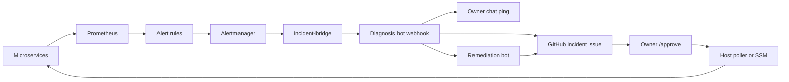
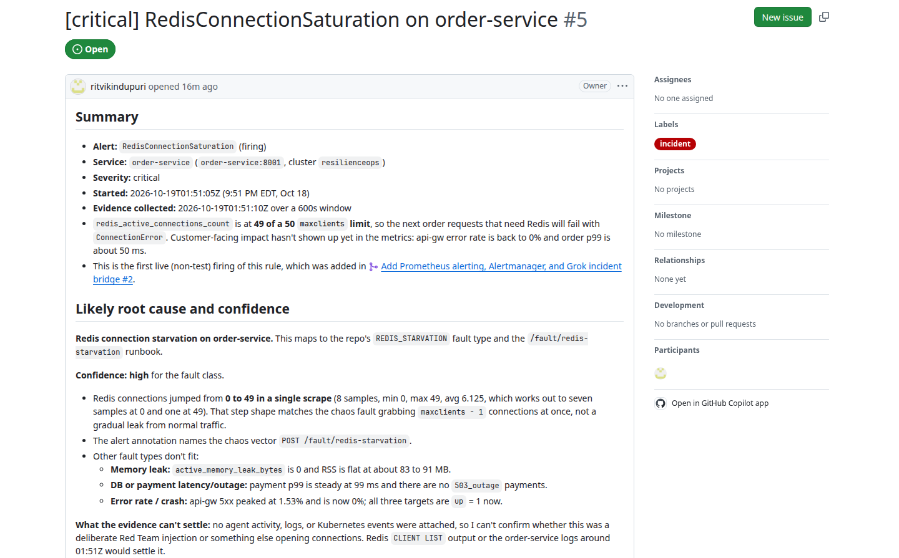
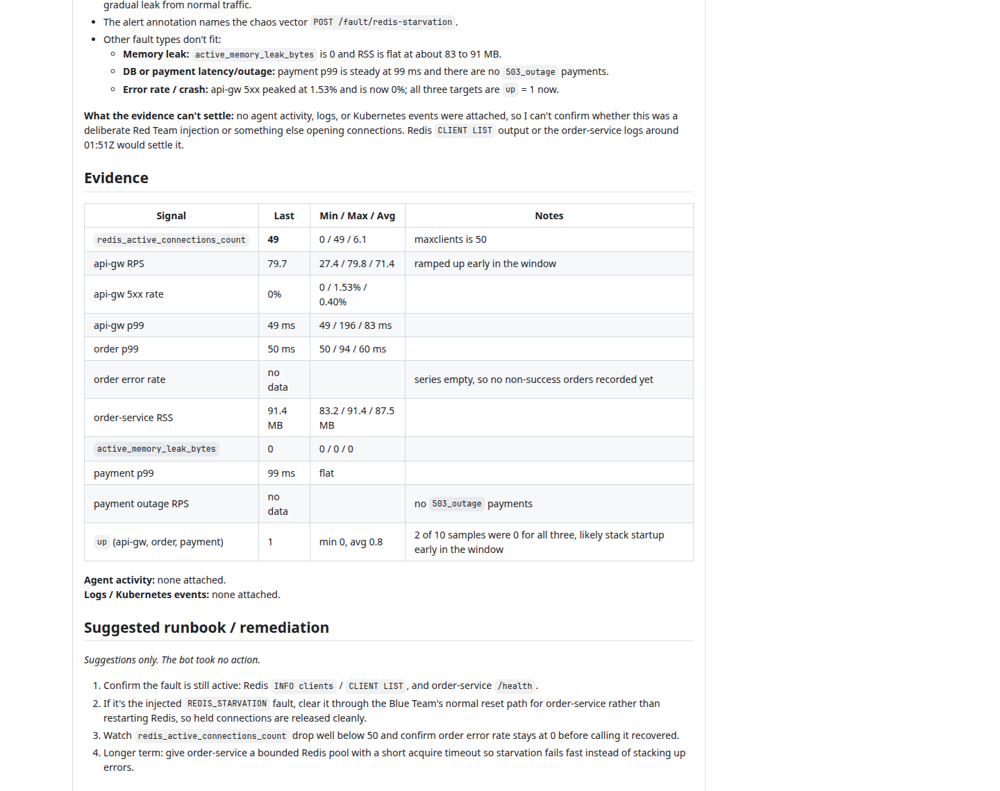
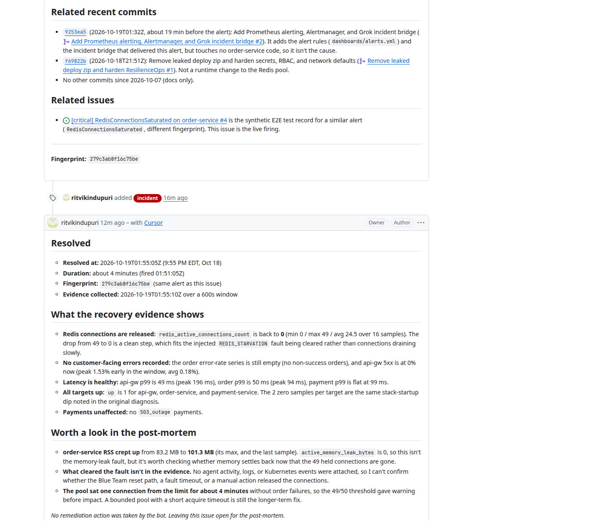
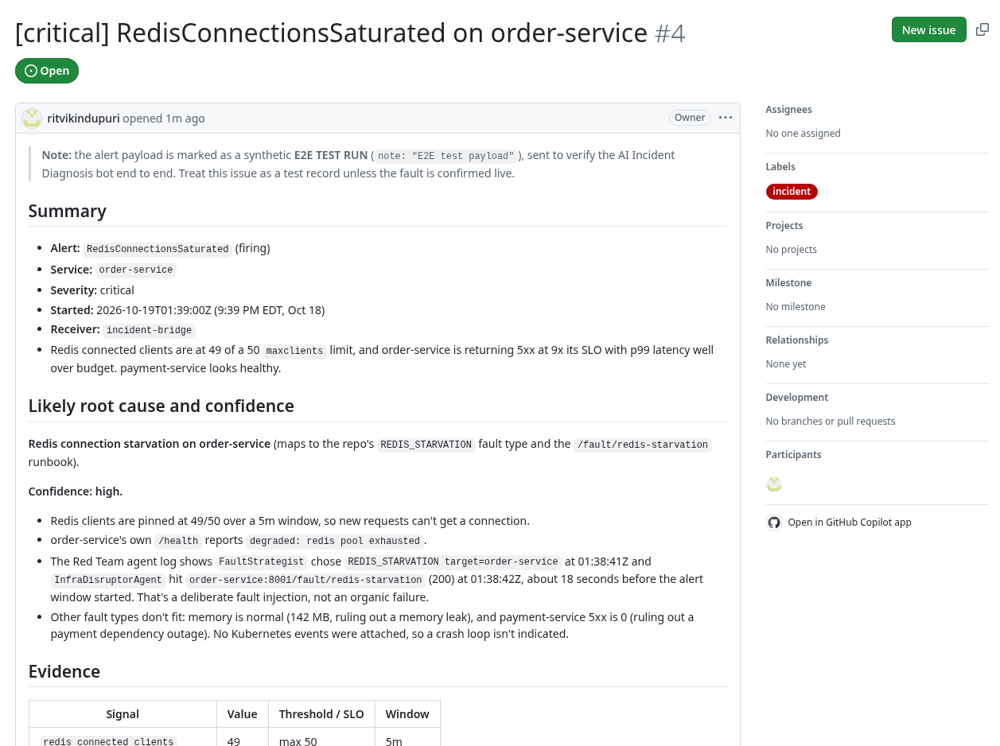
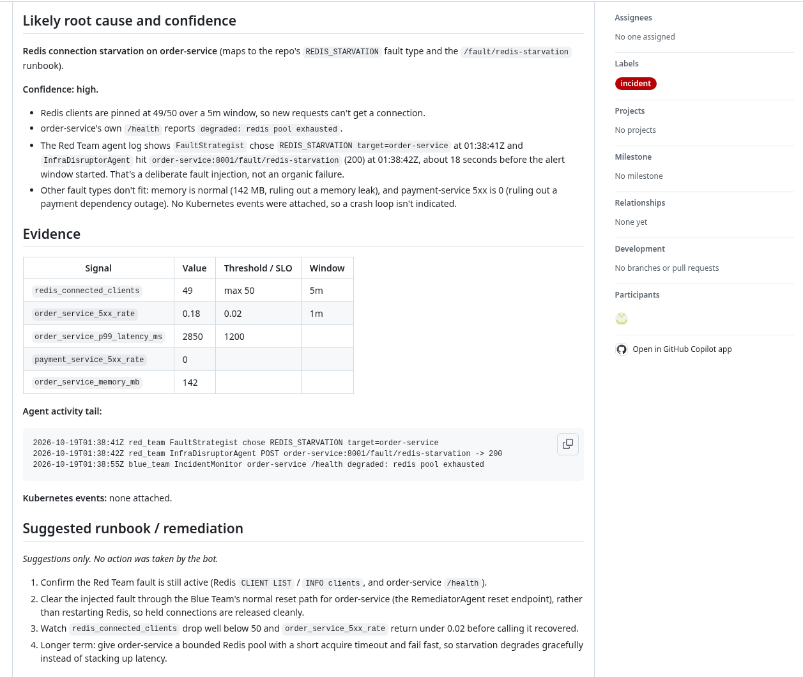
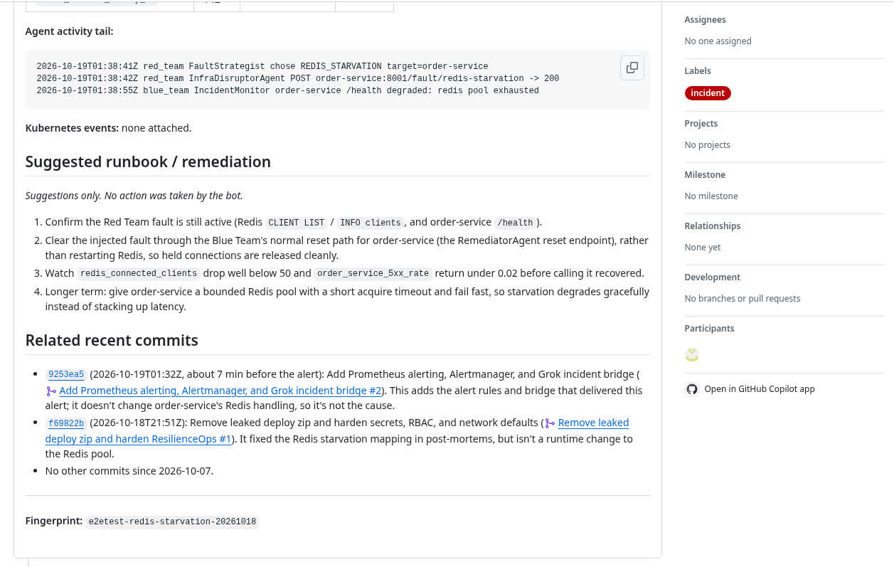

# ResilienceOps

An SRE lab: three FastAPI services, real faults, Prometheus alerts, and two importable Grok bots.

- **[AI Incident Diagnosis](https://x.ai/bot/feQpDSeSki7HVgkDCBUaY)** opens a GitHub `incident` issue. It has [no control path into the lab](#read-these-once).
- **[Incident Remediation](https://x.ai/bot/8rxdqPVj5W-mksKhNfcw5)** is invoked only by the Diagnosis bot. The fix runs only after `/approve`, on the machine that can see Compose (or [`--via-ssm`](#read-these-once)).

This README is the source of truth. The [technical documentation PDF](docs/ResilienceOps_Technical_Documentation.pdf) is a historical brief. Dated telemetry: [RESULTS.md](RESULTS.md). Claim-to-evidence: [`docs/ACCURACY.md`](docs/ACCURACY.md).

The diagnosis bot receives alerts and writes GitHub issues (webhook in, GitHub out). Internals — hold time, EC2 `.env`, SSM, and what the lab actually faults — are in [Reference](#reference).

## Table of contents

- [Prerequisites](#prerequisites)
- [Quick start (local)](#quick-start-local)
- [Set up both bots](#set-up-both-bots)
- [How to use](#how-to-use)
- [AWS (optional)](#aws-optional)
- [Troubleshooting](#troubleshooting)
- [Reference](#reference)
  - [Read these once](#read-these-once)
  - [Key features](#key-features)
  - [Architecture](#architecture)
  - [How it works, step by step](#how-it-works-step-by-step)
  - [Code flow](#code-flow)
  - [Full environment table](#full-environment-table)
  - [Sample output: a real test run](#sample-output-a-real-test-run)
  - [Glossary](#glossary)

## Prerequisites

- **Git**, **Docker** with Compose v2 (`docker compose version`), and **Python 3.11** (3.10+ works). Commands use `python3`. Images and CI are `3.11`.
- A **GitHub fork** of this repo with **Issues** enabled (**Settings → General → Features**). The bots need read access to the code and read/write Issues on **that fork only**.
- **Grok Bot** access to import both templates (links in [Set up both bots](#set-up-both-bots)).
- **Optional:** `ANTHROPIC_API_KEY` for Red/Blue agents. Skip it if you only want Path B/C (alerts + bots).
- **AWS only:** AWS CLI v2, Terraform 1.5+, `session-manager-plugin` (for `aws ssm start-session`). See [AWS (optional)](#aws-optional) — skip local Compose if you deploy there.

| You want | Do this |
|---|---|
| Local lab (default) | [Quick start](#quick-start-local) + [both bots](#set-up-both-bots) on your laptop |
| AWS lab | [AWS](#aws-optional) — skip `docker compose up` on the laptop |
| Red/Blue agents | Optional. Local: `docker compose --profile agents` or `python3 orchestrator.py`. AWS: `--profile agents` or the [k3s sandbox](#optional-k3s-sandbox) |

## Quick start (local)

**AWS users:** skip this Compose lab. Go to [AWS (optional)](#aws-optional).

### 1. Clone your fork

```bash
git clone https://github.com/<you>/ResilienceOps.git
cd ResilienceOps
```

### 2. Create `.env`

```bash
# Linux / macOS / Git Bash:
cp .env.example .env

# Windows PowerShell:
Copy-Item .env.example .env
```

Fill Grafana now so Compose can start. Webhook and poller keys are filled later in [Set up both bots](#set-up-both-bots). Do not commit `.env` ([SECURITY.md](SECURITY.md)). Full list in [Reference](#full-environment-table).

| Variable | When |
|---|---|
| `GRAFANA_ADMIN_USER` | Fill now. Compose fails without it (`${GRAFANA_ADMIN_USER:?Set GRAFANA_ADMIN_USER}`) |
| `GRAFANA_ADMIN_PASSWORD` | Fill now. No `admin`/`admin` default |
| `GROK_WEBHOOK_URL` | Filled later in [Set up both bots](#set-up-both-bots) |
| `GROK_WEBHOOK_KEY` | Filled later in [Set up both bots](#set-up-both-bots) |
| `GROK_WEBHOOK_AUTH_HEADER` | Filled later in [Set up both bots](#set-up-both-bots) |
| `GROK_WEBHOOK_AUTH_SCHEME` | Filled later in [Set up both bots](#set-up-both-bots) |
| `GITHUB_REPOSITORY` | Filled later in [Set up both bots](#set-up-both-bots) |
| `GITHUB_TOKEN` | Filled later in [Set up both bots](#set-up-both-bots) |

**Optional:** `ANTHROPIC_API_KEY` (Red/Blue). `POSTGRES_PASSWORD` defaults to `sre_password`.

`orchestrator.py` loads `.env` via `python-dotenv` in `agents/common/llm_engine.py` (does not override the process). Compose interpolates `.env` itself.

### 3. Start Compose

```bash
docker compose config >/dev/null
docker compose up --build -d
```

The first build pulls base images and compiles the FastAPI services. That can take several minutes.

**You should see:** `docker compose config` exits 0 with no output. `docker compose ps` shows `api-gw`, `order-service`, `payment-service`, Prometheus, Alertmanager, `incident-bridge`, Grafana, and `traffic-generator` as running / healthy. A `Bake, but buildx isn't installed` warning is harmless.

If Grafana vars are empty, Compose exits non-zero:

```text
error while interpolating services.grafana.environment.[]: required variable GRAFANA_ADMIN_USER is missing a value: Set GRAFANA_ADMIN_USER
```

After the stack is healthy, snapshot last-good image IDs (needed before `rollback_deploy`). From the **repo root**, `python3` is enough — no extra pip for this command:

```bash
python3 remediation/remediate.py record-last-good
```

**You should see** (`indent=2`):

```json
{
  "ok": true,
  "services": [
    "api-gw",
    "order-service",
    "payment-service"
  ]
}
```

and `logs/last_good_deploy.json` (or `$REMEDIATION_STATE_DIR/last_good_deploy.json`).

Host-side agents / pytest only (service images install their own packages):

```bash
python3 -m pip install -r requirements.txt
python3 -m pip install -r services/incident-bridge/requirements.txt
```

`agent-sandbox` is **opt-in** and needs `ANTHROPIC_API_KEY`. It does not start on a plain `docker compose up`. Its `CMD` is `python orchestrator.py --cycles 5 --delay 10` and it honors [`FAULT_HOLD_SECONDS`](#read-these-once):

```bash
docker compose --profile agents up -d --build agent-sandbox
```

Or on the host: `python3 orchestrator.py --cycles 1 --scenario MEMORY_EXHAUSTION`.

## Set up both bots

Work on **your fork**. Do not point the bots at someone else’s repo.

### Fork and GitHub access

1. Fork this repository.
2. Enable **Issues** (**Settings → General → Features**).
3. Enable **Actions** (open the **Actions** tab and enable workflows). `/approve` does nothing if Actions is off.
4. Connect GitHub when each bot asks in its **first chat**, and grant it access to **your fork only**.

### AI Incident Diagnosis

This bot receives alerts. It is **not** the remediator. Do not paste remediator secrets into `GROK_WEBHOOK_*`.

1. Import **[AI Incident Diagnosis](https://x.ai/bot/feQpDSeSki7HVgkDCBUaY)** (creates your own copy).
2. Connect GitHub when the bot asks in its first chat, and grant it access to your fork only.
3. In that first chat, name the GitHub repo (`owner/name`), the alert source (Prometheus / ResilienceOps), and whether to ping you on firing **critical** alerts.

The Diagnosis bot gives you a webhook URL and key; use the header and scheme it tells you.

Copy those values into `.env` (no trailing spaces):

1. Webhook URL → `GROK_WEBHOOK_URL`
2. Webhook key → `GROK_WEBHOOK_KEY`
3. Header name → `GROK_WEBHOOK_AUTH_HEADER`
4. Scheme → `GROK_WEBHOOK_AUTH_SCHEME`

Save `.env`, then recreate the bridge so it picks up the file:

```bash
docker compose up -d incident-bridge
curl -sS http://127.0.0.1:8088/healthz
```

**You should see** `"webhook_configured":true`. If you still see `false`, the process started before the URL was set — recreate the bridge again. Empty URL is `false` and the bridge drops payloads (`GROK_WEBHOOK_URL is unset; dropping alert payload`).

On AWS later, `python3 scripts/put_lab_secrets.py --region "$AWS_REGION"` copies these into Parameter Store (prints **names + lengths only**). Empty `GROK_WEBHOOK_AUTH_SCHEME` is stored as `__EMPTY__` (SSM rejects `""`).

### Incident Remediation

A **second** bot in the **same Grok account**. Only the Diagnosis bot’s webhook goes in `.env`. Do not paste anything from this bot into `GROK_WEBHOOK_*`.

1. Import **[Incident Remediation](https://x.ai/bot/8rxdqPVj5W-mksKhNfcw5)**.
2. Connect GitHub when the bot asks in its first chat, and grant it access to **the same fork**.
3. Keep both bots in the same account so Diagnosis can message it.
4. Create the [poller token](#poller-token) and put `GITHUB_REPOSITORY=owner/name` plus `GITHUB_TOKEN` in `.env`. The poller reads `.env` at run time. The `/approve` → Actions → poller path still needs this token.

When a proposal should appear, see [How it works step 7](#how-it-works-step-by-step). If it does not, see [No proposal appeared](#no-proposal-appeared).

#### Poller token

Create a token **before** you need the poller. Never commit it. The poller reads `.env` at run time.

- **Fine-grained:** repository access = your fork only; **Issues: Read and write**. Metadata read is automatic.
- **Classic:** scope `repo`.

`.github/workflows/remediation-approve.yml` must be on the **default** branch (`issue_comment` workflows run from there). It **records** `/approve`. It does not execute the fix. The workflow name is `record remediator approval`.

The poller and Actions require this exact block (one block, two fields):

```
<!-- resilienceops-proposal:v1 -->
action: reset_fault
target: order-service
<!-- /resilienceops-proposal -->
```

`record-last-good` is not part of this step. It lives only in [Quick start](#quick-start-local) (and on the EC2 host after deploy).

## How to use

**Before you start: finish setup.** Both bots imported, Compose up (or AWS deploy done), `curl -sS http://127.0.0.1:8088/healthz` shows `"webhook_configured":true`, and `record-last-good` has been run on the machine that owns the stack.

1. **Confirm the shop is healthy.**

   ```bash
   curl -sS http://127.0.0.1:8001/ready
   curl -sS http://127.0.0.1:8088/healthz
   ```

   **You should see** order-service `"status":"healthy"` and `"webhook_configured":true`.

2. **Inject a test fault** (optional — live outages trip the same rules without `/fault`):

   ```bash
   curl -sS -X POST 'http://127.0.0.1:8001/fault/redis-starvation'
   ```

   Expect ~49 Redis clients. Watch `http://127.0.0.1:9090/alerts` until **RedisConnectionSaturation** is firing (`for: 5s`, `>= 48`). The sibling warning is **inhibited** while critical is firing.

3. **Read the diagnosis issue.** The diagnosis bot [has no control path into the lab](#read-these-once). Sample hop times: [issue #5](https://github.com/ritvikindupuri/ResilienceOps/issues/5) (**12.1 s** fault→webhook, **~61 s** to the issue).

4. **Wait for the remediator proposal.** See [How it works step 7](#how-it-works-step-by-step). If none appears, see [No proposal appeared](#no-proposal-appeared).

5. **Approve.** On that issue, comment exactly:

   ```
   /approve
   ```

   **You should see** a recorded-approval comment, the `remediation-approved` label, and a **green** **record remediator approval** run on the Actions tab. GitHub Actions does **not** touch the stack.

6. **Run the fix on the machine that can see Compose.**

   Laptop (uses `.env` `GITHUB_REPOSITORY=owner/name`):

   ```bash
   python3 remediation/poll_and_apply.py --once
   ```

   EC2 host ([root-owned `.env`](#read-these-once)):

   ```bash
   cd /opt/sre-colosseum && sudo python3 remediation/poll_and_apply.py --once
   ```

   From a laptop onto that host ([`--via-ssm`](#read-these-once)):

   ```bash
   python3 remediation/poll_and_apply.py --once --via-ssm
   python3 remediation/remediate.py --action reset_fault --target both --via-ssm
   ```

   **You should see** a result comment and, on success, `remediation-applied`.

7. **Check recovery.** `RedisConnectionSaturation` goes inactive; `curl -sS http://127.0.0.1:8001/health` is healthy; `redis_active_connections_count` is back under 40.

Stop the local lab: `docker compose down -v`.

Synthetic check (no `/fault`): `python3 scripts/send_test_alert.py --target alertmanager` — Alertmanager prints `200`. Confirm the bridge with `docker compose logs --tail 20 incident-bridge`. `--target bridge` hits `127.0.0.1:8088` (`200 {"accepted":true}`).

## AWS (optional)

Skip local Compose. The same stack runs on one EC2 host after Terraform + `put_lab_secrets.py` + `deploy_remote.py`.

Clone your fork first ([Quick start](#quick-start-local) step 1). Fill `.env` Grafana + webhook + poller keys on the **laptop** — `put_lab_secrets.py` reads that file. `deploy_remote.py` does **not**.

### Two AWS identities

Two people (or two logins):

1. **Admin, once.** Creates the customer-managed policy `ResilienceOpsDeployer` from `terraform/deployer-policy.json` (inline user policies are capped at 2,048 characters; this document is larger).
2. **Deployer, day to day.** Uses that policy to run Terraform, `put_lab_secrets.py`, `deploy_remote.py`, and [`--via-ssm`](#read-these-once). A read-only identity 403s on `ec2:CreateVpc` / `iam:CreateRole`.

```bash
export AWS_REGION=us-east-1
export AWS_DEFAULT_REGION="$AWS_REGION"

ACCOUNT_ID=$(aws sts get-caller-identity --query Account --output text --region "$AWS_REGION")
sed "s/ACCOUNT_ID/${ACCOUNT_ID}/g" terraform/deployer-policy.json > /tmp/resilienceops-deployer-policy.json
POLICY_ARN=$(aws iam create-policy --policy-name ResilienceOpsDeployer \
  --policy-document file:///tmp/resilienceops-deployer-policy.json \
  --query 'Policy.Arn' --output text)
aws iam attach-user-policy --user-name <YOUR_IAM_USER> --policy-arn "$POLICY_ARN"
# If you authenticate as a role:
# aws iam attach-role-policy --role-name <YOUR_IAM_ROLE> --policy-arn "$POLICY_ARN"

aws iam list-attached-user-policies --user-name <YOUR_IAM_USER>
aws sts get-caller-identity --region "$AWS_REGION"
```

**You should see** `ResilienceOpsDeployer` in `list-attached-user-policies`. Console: **IAM → Policies → Create policy → JSON**, then attach it to the user or role.

The policy covers EC2/VPC create+delete, `iam:CreateRole` / `DeleteRole` / `PassRole` (to `ec2.amazonaws.com` on `sre-platform-host-role` only), instance-profile, `ssm:SendCommand` / `GetCommandInvocation` / `DescribeInstanceInformation` / `PutParameter` / `GetParameter`, S3 on `sre-resilienceops-deploy-*`, and CloudWatch log-group/stream create/delete. The **instance** role is separate (`AmazonSSMManagedInstanceCore` + inline GetParameter / S3 GetObject / `logs:CreateLogStream` / `PutLogEvents`).

### Terraform

```bash
cp terraform/terraform.tfvars.example terraform/terraform.tfvars
```

Set `allowed_cidr` to your `/32` or office CIDR (`curl -sS https://checkip.amazonaws.com`, then append `/32`). `0.0.0.0/0` is rejected. Set `aws_region` to the **same** value as `$AWS_REGION` (Terraform, AWS CLI, and the Python scripts default independently).

Port 22 is closed. SSM Session Manager does not need inbound SSH. Grafana `:3000` and API `:8000` still use `allowed_cidr` unless you SSM port-forward.

```bash
export AWS_REGION="${AWS_REGION:-us-east-1}"
export AWS_DEFAULT_REGION="$AWS_REGION"
terraform -chdir=terraform init
terraform -chdir=terraform plan
terraform -chdir=terraform apply
```

| What | Command / check |
|---|---|
| Create the VPC, subnets, SG, IAM instance role, S3 deploy bucket, CloudWatch log groups, EC2 host | `terraform -chdir=terraform apply` |
| **You should see** | Terraform prints `Apply complete!` |
| Export outputs | `export AWS_REGION=$(terraform -chdir=terraform output -raw region)` and `instance_id` / `deploy_bucket` the same way |

Default instance is **`t3.medium`**. `user_data` installs Docker Compose v2, `awscli`, unzip, 2G swap, and k3s. IMDSv2 hop limit is 2 so containers can reach instance credentials.

| Resource | Terraform name | AWS Name / CIDR | What runs there |
|---|---|---|---|
| VPC | `aws_vpc.sre_vpc` | `sre-enterprise-vpc` `10.0.0.0/16` | Boundary |
| IGW | `aws_internet_gateway.igw` | `sre-enterprise-igw` | Public default route |
| Public RT | `aws_route_table.public_rt` | `sre-public-route-table` | Associated only with `public_ingress` |
| Public subnet | `aws_subnet.public_ingress` | `sre-subnet-public-ingress` `10.0.1.0/24` | **Used:** EC2 host |
| App subnet | `aws_subnet.app_workloads` | `sre-subnet-app-workloads` (`app_workloads 10.0.10.0/24`) | Created; unused |
| Data subnet | `aws_subnet.data_persistence` | `sre-subnet-data-persistence` (`data_persistence 10.0.20.0/24`) | Created; unused |
| Ingress SG | `aws_security_group.ingress_sg` | `sre-ingress-sg` | Grafana `3000` and API `8000` from `allowed_cidr` |
| Internal SG | `aws_security_group.internal_app_sg` | `sre-internal-app-sg` | `8001–8002` from ingress; self scrape |
| IAM | `aws_iam_role.sre_host_role` + instance profile | `sre-platform-host-role` | SSM; GetParameter `/resilienceops/*`; S3 GetObject; `logs:PutLogEvents` |
| S3 | `aws_s3_bucket.deploy` | `sre-resilienceops-deploy-<account>-<region>` | Zip payloads (SSM 100 KB limit) |
| Logs | `aws_cloudwatch_log_group.audit` / `.incidents` | `/sre/autonomous-agent-audit`, `/sre/autonomous-agent-incidents` | Groups only |
| Host | `aws_instance.sre_host` | `sre-enterprise-platform-host` | Compose + k3s; IMDS hop 2 |

Prometheus `9090` and SSH `22` are **not** on `ingress_sg`. `deploy_remote.py` binds the instance **private IP**:9090 so k3s can query it (never `0.0.0.0`).

```bash
export AWS_REGION=$(terraform -chdir=terraform output -raw region)
export AWS_DEFAULT_REGION="$AWS_REGION"
export EC2_INSTANCE_ID=$(terraform -chdir=terraform output -raw instance_id)
export DEPLOY_BUCKET=$(terraform -chdir=terraform output -raw deploy_bucket)
```

Typical outputs: `api_gateway_url`, `grafana_url`, `instance_id`, `private_ip`, `public_ip`, `deploy_bucket`, `region`, `prometheus_url` (`http://127.0.0.1:9090` via SSM).

<p align="center">
  
</p>
<p align="center"><b>Figure 3: Dated AWS console resource map of <code>sre-enterprise-vpc</code></b></p>

### Secrets and deploy

Do **not** put secret values in an SSM `SendCommand` document. Write Parameter Store **SecureString**s, then let the instance role `GetParameter` them into `/opt/sre-colosseum/.env`.

```bash
python3 scripts/put_lab_secrets.py --region "$AWS_REGION"
python3 deploy_remote.py --region "$AWS_REGION"
# Optional Red/Blue on the Compose network (needs ANTHROPIC_API_KEY in Parameter Store):
python3 deploy_remote.py --region "$AWS_REGION" --profile agents
```

`deploy_remote.py` waits for SSM **Online** and `cloud-init status --wait`, uploads the zip, writes the host `.env` (plus `PROMETHEUS_BIND` / `COMPOSE_FILE=docker-compose.yml:docker-compose.prom-lan.yml` / `AWS_REGION`), and runs `docker compose -f docker-compose.yml -f docker-compose.prom-lan.yml up --build -d`.

**You should see:** `SSM agent Online on i-…`, then `SSM command … status=Success`, then `Deploy finished. Grafana vars came from Parameter Store; secrets were not in SendCommand.` (`deploy_remote.send_and_wait` requires `Status=Success`.)

On the host, snapshot last-good images (or from the laptop with [`--via-ssm`](#read-these-once)):

```bash
# SSM session, then:
cd /opt/sre-colosseum && sudo python3 remediation/remediate.py record-last-good
```

### Optional k3s sandbox

Default AWS apps stay in **Compose**, not in `k8s/apps/microservices.yaml` (pass `--apply-microservices` only if you built `sre-arena/*` images). `sre-target-apps` is empty on the documented path, so Blue restart/scale is a no-op unless those pods exist (`K8sToolKit.k8s_available`).

```bash
python3 deploy_k8s_sandbox.py --region "$AWS_REGION"
```

That applies `k8s/base/namespace-rbac.yaml` then `k8s/agents/agent-sandbox.yaml`, copies `agents/`, `orchestrator.py`, and `reports/` into `/app` (`workingDir: /app` in `k8s/agents/agent-sandbox.yaml`), and points `API_*` / `PROMETHEUS_URL` at the **EC2 private IP**. `copy_code_to_sandbox.py` is the copy-only follow-up if the pod was recreated.

```bash
aws ssm start-session --target "$EC2_INSTANCE_ID" --region "$AWS_REGION"
```

On the host, private IP from IMDSv2 (laptop `terraform output` is not in this shell):

```bash
TOKEN=$(curl -sS -X PUT "http://169.254.169.254/latest/api/token" -H "X-aws-ec2-metadata-token-ttl-seconds: 21600")
PRIVATE_IP=$(curl -sS -H "X-aws-ec2-metadata-token: $TOKEN" http://169.254.169.254/latest/meta-data/local-ipv4)
k3s kubectl exec -it deployment/red-team-sandbox -n sre-agent-sandbox -- \
  python3 orchestrator.py --target-ip "$PRIVATE_IP" --cycles 1 --scenario MEMORY_EXHAUSTION
```

Other `--scenario` values: `REDIS_CONNECTION_STARVATION`, `CPU_SATURATION`, `NETWORK_LATENCY`, `PACKET_LOSS`. Each cycle honors [`FAULT_HOLD_SECONDS`](#read-these-once).

<details>
<summary>Sandbox security (CPU/RAM, RBAC, NetworkPolicy)</summary>

| Pillar | Enforcement |
|---|---|
| Resource limits | `500m` CPU / `512Mi` RAM. A runaway agent OOMs (`Exit 137`). Host daemons stay up. Limits do not dampen faults in the target services. |
| RBAC | Namespaced Roles on `sre-target-apps` only. Red: `get`/`list`/`watch` on pods + `pods/exec`. Blue: get/list/watch/delete pods, get logs/events, patch/update deployments/scale. No cluster-admin. |
| Egress | DNS 53; pods in `arena.sre.io/role=victim`; TCP 443; TCP `8000`/`8001`/`8002`/`9090` to `10.0.0.0/16`. The diagnosis webhook is sent by **incident-bridge**, not by the sandbox. |

</details>

### Open Grafana and run a cycle

`http://<public-ip>:3000` with `GRAFANA_ADMIN_USER` / `GRAFANA_ADMIN_PASSWORD`. Dashboard **SRE & Reliability → SRE Infrastructure & Reliability Performance Monitor** (1s, Golden Signals). Screenshots: [RESULTS.md](RESULTS.md). Some reports there still use the pre-fix `UNKNOWN_FAULT` title; current generator: [`reports/example_incident_memory_exhaustion.md`](reports/example_incident_memory_exhaustion.md).

CloudWatch: log group `/sre/autonomous-agent-audit`. Optional `python3 create_cw_dashboard.py` → `SRE-Autonomous-Agent-Security-Audit`; `python3 test_grafana_proxy.py` → `SRE-fault-Vectors-Live-Telemetry`. Dated screenshots used console names `Agent-Command-Log` and `System-Fault-Metrics`.

Then follow [How to use](#how-to-use) against the host (SSM port-forward `127.0.0.1:9090` / `:8088` as needed). Poller: `cd /opt/sre-colosseum && sudo python3 remediation/poll_and_apply.py --once`.

### Teardown

```bash
export AWS_REGION="${AWS_REGION:-$(terraform -chdir=terraform output -raw region 2>/dev/null || echo us-east-1)}"
export AWS_DEFAULT_REGION="$AWS_REGION"
./teardown.sh          # Windows: .\teardown.ps1
# or: terraform -chdir=terraform destroy
```

SSM parameters are **not** in Terraform state. Detach `ResilienceOpsDeployer` from an **admin** login (`terraform destroy` does not delete it):

```bash
ACCOUNT_ID=$(aws sts get-caller-identity --query Account --output text --region "$AWS_REGION")
POLICY_ARN="arn:aws:iam::${ACCOUNT_ID}:policy/ResilienceOpsDeployer"
aws iam detach-user-policy --user-name <YOUR_IAM_USER> --policy-arn "$POLICY_ARN"
aws iam delete-policy --policy-arn "$POLICY_ARN"
```

## Troubleshooting

### No GitHub issue after an alert

1. `curl -sS http://127.0.0.1:8088/healthz` — expect `"webhook_configured":true` (else recreate the bridge).
2. `docker compose logs incident-bridge`. The key is never printed.
3. Confirm the four `GROK_WEBHOOK_*` values match the diagnosis routine.
4. Confirm GitHub is connected and the first chat named **your fork**.
5. `curl -sS http://127.0.0.1:9093/-/healthy`.

### Webhook 401 / 403

Wrong key, or `GROK_WEBHOOK_AUTH_HEADER` / `GROK_WEBHOOK_AUTH_SCHEME` does not match the routine. Recopy the four values, then `docker compose up -d incident-bridge`.

### No proposal appeared

Diagnosis is the only caller. Ask the Diagnosis bot to hand off issue #N, or message the Remediation bot directly: `Check issue #N in owner/name and post a proposal.` Confirm both bots are in the same account and GitHub is connected to the same fork. The Remediation bot has no webhook and does not watch the repo.

### `/approve` did nothing

Lone `/approve` on an **issue** (not a PR) labeled `incident`, from the owner or `write` / `maintain` / `admin`. Bots rejected. A valid proposal block must already be on the issue. Actions must be enabled. Check the Actions tab for `record remediator approval`.

### Poller skips

Looks for `incident` + `remediation-approved`, without `remediation-applied`. On EC2 use the [sudo command](#read-these-once). `no recorded approval block` means Actions has not commented yet.

### Duplicate issues vs comments

Same fingerprint + an already-open `incident` issue → the diagnosis bot **comments**. Bridge dedupe: same `fingerprint`+`status` at most once per `DEDUPE_TTL_SECONDS` (300). Resolved is a different status.

### Containers cannot reach each other

Host `curl 127.0.0.1:8088/healthz` can work while container DNS fails (FORWARD / iptables). Prometheus targets stay **down**; Alertmanager logs `Notify for alerts failed ... context deadline exceeded`; bridge logs `ConnectTimeout` or `forward FAILED after N attempts`.

```bash
docker exec "$(docker compose ps -q alertmanager)" wget -T 3 -qO- http://incident-bridge:8080/healthz
docker exec "$(docker compose ps -q prometheus)" wget -T 3 -qO- http://api-gw:8000/metrics
docker exec "$(docker compose ps -q incident-bridge)" python -c "import urllib.request; urllib.request.urlopen('http://prometheus:9090/-/healthy', timeout=3)"
```

If those time out, fix the host Docker FORWARD policy and restart Docker. Dead-letter: `logs/bridge_deadletter.jsonl` (no key). The ASGI app stays up (`{"accepted":true}`).

### Bake / buildx warning

Compose v2 message. The stack still builds with the default docker driver.

## Reference

### Read these once

Later sections link here instead of repeating these sentences.

- **No control path into the lab.** The diagnosis bot only receives webhooks and writes GitHub issues (webhook in, GitHub out). It never restarts, scales, rolls back, or pushes code.
- **`FAULT_HOLD_SECONDS` defaults to 120.** Path A (`orchestrator.py`) holds the fault so Prometheus `for:` windows can fire, then always calls `FaultCatalog.reset_environment()` in `finally`. Set `0` to skip the hold. `/fault/cpu-burn` (15s) and `/fault/crash` are not standing faults — the burn ends on its own, and Compose `restart: unless-stopped` brings `order-service` back.
- **EC2 `.env` is root-owned.** `deploy_remote.py` writes `/opt/sre-colosseum/.env`. On that host run `cd /opt/sre-colosseum && sudo python3 remediation/poll_and_apply.py --once`. If the process cannot read the file, `remediation/envload.py` skips it quietly and does not print secrets.
- **`--via-ssm`** reuses `deploy_remote.send_and_wait` (`ssm.send_command` / `AWS-RunShellScript` in `/opt/sre-colosseum`). Needs `EC2_INSTANCE_ID`, `AWS_REGION`, `boto3`, and laptop credentials that can `ssm:SendCommand`. `--verify-timeout` is forwarded. An SSM failure posts a result comment with `ok: false`. No new IAM is added.

### Key features

- Real kernel and cgroup faults (`tc netem` on `eth0`, heap leaks that can OOM, CFS CPU burn, Redis `maxclients` starvation) — not mock metrics.
- Optional Red/Blue agents (`orchestrator.py`) that inject, detect, reset, and write `reports/incident_*.md`. They do **not** open GitHub issues.
- Diagnosis bot: Prometheus → Alertmanager → incident-bridge → webhook → `incident` issue (and a chat ping on firing **critical** alerts).
- Remediation bot: allowlisted `reset_fault`, `restart_service`, or `rollback_deploy` after `/approve`. See [step 7](#how-it-works-step-by-step).
- Grafana at 1s scrape on `:3000`. Optional AWS EC2 + k3s sandbox. CloudWatch log groups `/sre/autonomous-agent-audit` and `/sre/autonomous-agent-incidents` (Terraform creates the groups; dashboards are helper scripts).

### Architecture

<p align="center">
  
</p>
<p align="center"><b>Figure 1.</b> Orange = diagnosis, blue = remediation. Numbers match the steps below.</p>

<p align="center">
  
</p>
<p align="center"><b>Figure 2: Kubernetes Agent Sandbox Pod Architecture, Resource Limits & Egress Network Rules</b></p>

<details>
<summary>Figure source (contributors)</summary>

Grey edges are supporting (optional AWS deploy, Grafana, Red/Blue, PromQL query). incident-bridge queries Prometheus. Claim-to-evidence: [`docs/ACCURACY.md`](docs/ACCURACY.md).

Rebuild Figure 1 from [`docs/architecture.svg`](docs/architecture.svg) with `scripts/render_architecture.sh` / `scripts/build_architecture.py`. Companion mermaid (same flow, no logos): [`docs/architecture.mmd`](docs/architecture.mmd). See also [docs/README.md](docs/README.md).

</details>

### How it works, step by step

Figure 1 badges are Path B then Path C. Path A is Red/Blue in one `orchestrator.py` process (`docker compose --profile agents`, host CLI, or optional k3s). Red faults (grey, unnumbered) hit **order-service and payment-service only**. Blue checks health on all 3 and resets order-service and payment-service. [`FAULT_HOLD_SECONDS`](#read-these-once) applies on Path A.

| Path | Who | What |
|---|---|---|
| **A — Blue Team** | `orchestrator.py` | Inject, watch, hold, reset, write `reports/incident_*.md`. No GitHub issues. |
| **B — Diagnosis** | Prom → AM → bridge → [diagnosis bot](https://x.ai/bot/feQpDSeSki7HVgkDCBUaY) | Webhook in, `incident` issue out. [No lab control](#read-these-once). |
| **C — Remediation** | Diagnosis hands off → [Remediation bot](https://x.ai/bot/8rxdqPVj5W-mksKhNfcw5) → `/approve` → poller | Actions **records**. Host (or [`--via-ssm`](#read-these-once)) executes. |

1. **Scrape.** Prometheus pulls `/metrics` from **all 3** services every 1s (`dashboards/prometheus.yml`).
2. **Alert.** Firing rules go to Alertmanager (`dashboards/alertmanager.yml`, compose `alertmanager:9093`, host `127.0.0.1:9093`).
3. **Evidence.** Alertmanager POSTs to `incident-bridge:8080/webhook` (`send_resolved: true`). The bridge adds PromQL range summaries plus tailed `logs/agent_activity.jsonl` (jsonl only when `--profile agents` or a host orchestrator is writing it). incident-bridge queries Prometheus (dashed edge). No Kubernetes client in the Compose bridge image.
4. **Diagnosis.** The diagnosis bot reads the webhook. [No control path](#read-these-once).
5. **Issue.** Opens or comments on a GitHub issue labeled `incident` (same fingerprint → comment).
6. **Owner ping.** Firing **critical** alerts also ping the owner.
7. **Handoff.** Diagnosis asks the Remediation bot (same account) to propose a fix. The Remediation bot does not watch the repo.
8. **Proposal.** Remediation comments one allowlisted action on that GitHub issue.
9. **Approve.** `/approve`. Actions records; it does not run the fix.
10. **Fix.** `python3 remediation/poll_and_apply.py` on the lab host, or [`--via-ssm`](#read-these-once). Then Prometheus until the alert clears or `--verify-timeout` expires.



Traffic always runs: compose `traffic-generator` POSTs `api-gw:8000` at `RPS_TARGET` (compose default **20**; `traffic-generator/load_generator.py` defaults to **25** only if you run it on the host with no env). `api-gw` reverse-proxies `/api/orders*` to `order-service:8001` and `/api/payments*` to `payment-service:8002`. Grafana (`:3000`) is PromQL only — not on the alert path.

### Code flow

<details>
<summary>What the code does after a fault (Fault injection → Resolution)</summary>

1. **Fault injection** (`orchestrator.py` phases 2–3) — `faultStrategistAgent.plan_campaign` then either `InfraDisruptorAgent.execute_fault` (order-service `POST /fault/leak-memory`, `/fault/redis-starvation`, `/fault/cpu-burn`, `/fault/crash`) or `NetworkAdversaryAgent.execute_fault` (payment-service `tc netem` via `/fault/latency` or `/fault/drop-rate`). `--scenario` strings: `MEMORY_EXHAUSTION`, `REDIS_CONNECTION_STARVATION`, `CPU_SATURATION`, `NETWORK_LATENCY`, `PACKET_LOSS`. Dispatch is substring-based: `NETWORK` / `PACKET` / `LATENCY` → network; `REDIS` / `CPU` / `CRASH` → infra; else memory leak. Catalog names `KERNEL_TC_NETEM_LATENCY` / `KERNEL_TC_NETEM_PACKET_LOSS` also work.

2. **Detection** (phase 4) — `IncidentMonitor.inspect_telemetry` `GET`s `/health` on api-gw (4s), order-service, and payment-service. If `PROMETHEUS_URL` answers, it queries p99 of `http_request_duration_seconds` and the 5xx share of `http_requests_total`. `evaluate_slos` declares an incident when p99/probe latency > `SLO_MAX_P99_LATENCY_MS` (1200), error rate > `SLO_MAX_ERROR_RATE_PERCENT` (2), or HTTP >= 500. At most **9 ticks of 1s**. Then the [hold](#read-these-once). Prometheus evaluates `dashboards/alerts.yml` every 1s independently.

3. **Alert** — Prometheus → Alertmanager at `alertmanager:9093` (`group_wait: 5s`, `group_interval: 15s`, `repeat_interval: 1h`) → `http://incident-bridge:8080/webhook`.

4. **Enrichment** — `services/incident-bridge/app.py` builds PromQL summaries (`EVIDENCE_WINDOW_SECONDS` default 600) plus tailed `AGENT_ACTIVITY_LOG` jsonl. Payload `{status, alerts, evidence, source: "resilienceops"}`, cap `PAYLOAD_MAX_BYTES` (~100KB). Same `fingerprint`+`status` once per `DEDUPE_TTL_SECONDS` (300). Empty URL → drop. Failed POST after `WEBHOOK_MAX_RETRIES` → `forward FAILED after N attempts alertname=… fingerprint=…` and `logs/bridge_deadletter.jsonl`.

5. **Diagnosis** — Path A: `DiagnosticAgent.analyze` + `EnterpriseLLMEngine` (`MODEL_DIAGNOSTIC_RCA`, default `claude-sonnet-4-6`). Path B: diagnosis bot from evidence **plus recent commits**. [No lab control](#read-these-once).

6. **Issue** — `incident` label; same fingerprint comments. Path A writes `reports/incident_*.md` instead.

7. **Handoff** — Path C: Diagnosis asks the Remediation bot (same account) to propose a fix. The Remediation bot has no webhook and does not watch the repo.

8. **Proposal** — Remediation comments a `<!-- resilienceops-proposal:v1 -->` block with one allowlisted `action` + `target`. `remediation/actions.py` rejects extras, a second block, and `;|&$\` / `../` / URL injection.

9. **Approval** — lone `/approve`. `remediation/record_approval.py` comments `<!-- resilienceops-approval:v1 -->` and adds `remediation-approved`. **The workflow does not execute the fix.**

10. **Fix** — `poll_and_apply.py` → `remediate.py`. Laptop or EC2; [`--via-ssm`](#read-these-once) on AWS.

11. **Resolution** — Path A: `RemediatorAgent.execute_runbook` always `FaultCatalog.reset_environment()` (`POST /fault/reset` on order-service and payment-service). k8s restart/scale only if `K8sToolKit.k8s_available` **and** pods exist in `sre-target-apps`. `verify_recovery` GETs api-gw `/health` up to **5** times; success is HTTP 200 and probe latency **< 800ms**. `PostMortemGenerator.generate` writes `reports/incident_*.md`. StructuredLogger appends `logs/agent_activity.jsonl` and best-effort CloudWatch. Path B: resolved webhook → comment only. Path C: the host remediator is what POSTs `/fault/reset`, restarts one named Compose service, or rolls back.

</details>

#### Fix allowlist

| Action | Target | What it does | What it is not |
|---|---|---|---|
| `reset_fault` | `order-service`, `payment-service`, or `both` | `POST /fault/reset` on each named target | Not Path A `FaultCatalog.reset_environment` |
| `restart_service` | `api-gw`, `order-service`, or `payment-service` | `docker compose restart <name>` | Not redis/postgres/Prometheus/Grafana |
| `rollback_deploy` | those three, or `both` (all three, including api-gw) | Tags recorded last-good as `<project>-<service>:last-good` (`COMPOSE_PROJECT_NAME` or directory name with `[a-z0-9_-]`, so `sre-colosseum` stays hyphenated), writes a state-dir override (`image:` + `pull_policy: never`), `up --no-build --force-recreate`. Fails unless image ID equals last-good. Override lives only in `$REMEDIATION_STATE_DIR` | Not `git revert`, not a live-verified run |

`--dry-run` prints steps and exits. Manual: `python3 remediation/remediate.py --dry-run --action reset_fault --target both`. Local E2E (not in CI): `python3 remediation/e2e_local.py`. No secrets printed (`remediation/logutil.py`). Lines go to `$REMEDIATION_STATE_DIR/remediation.jsonl`.

### Full environment table

Every `os.getenv` / `_env_int` / `_env_float` name in the Python tree is listed in [`.env.example`](.env.example). Compose interpolates Grafana, Postgres, Grok webhook, bridge tunables, `RPS_TARGET` / `CONCURRENCY`, agent-sandbox `ANTHROPIC_API_KEY`, and SLO thresholds from the same file.

| Variable | Used by | Notes |
|---|---|---|
| `GRAFANA_ADMIN_USER` | compose Grafana | **Required.** Empty → compose interpolation error |
| `GRAFANA_ADMIN_PASSWORD` | compose Grafana | **Required.** No default |
| `ANTHROPIC_API_KEY` | `agents/common/llm_engine.py`, compose `agent-sandbox` | Optional. Empty still starts the sandbox |
| `POSTGRES_PASSWORD` | compose postgres + order-service | `${POSTGRES_PASSWORD:-sre_password}` |
| `EC2_INSTANCE_ID` | `agents.config.require_ec2_instance_id`, `deploy_remote.py` | Required before remote deploy; `terraform -chdir=terraform output -raw instance_id` |
| `SRE_EC2_INSTANCE_ID` | same helper | Alias for `EC2_INSTANCE_ID` |
| `AWS_REGION` | `agents/config.py`, deploy scripts | Default `us-east-1`. Must match `aws_region` in `terraform.tfvars` |
| `AWS_DEFAULT_REGION` | AWS CLI / boto3 | Same value as `AWS_REGION` |
| `DEPLOY_BUCKET` | `deploy_remote.py` | Terraform output `deploy_bucket` |
| `SSM_PARAM_PREFIX` | `scripts/put_lab_secrets.py`, `deploy_remote.py` | Default `/resilienceops` |
| `GROK_WEBHOOK_URL` | incident-bridge | Empty = drop (`webhook_configured: false`) |
| `GROK_WEBHOOK_KEY` | incident-bridge | Never logged |
| `GROK_WEBHOOK_AUTH_HEADER` | incident-bridge | Default `Authorization` |
| `GROK_WEBHOOK_AUTH_SCHEME` | incident-bridge | Default `Bearer`. Present-but-empty sends the raw key. AWS stores empty as `__EMPTY__`. Unset → Compose `Bearer` |
| `GITHUB_TOKEN` | `remediation/github_api.py`, Actions, `put_lab_secrets.py` | [Poller token](#poller-token). Actions provides `secrets.GITHUB_TOKEN` |
| `GH_TOKEN` | `remediation/github_api.py` | Alias if `GITHUB_TOKEN` is unset |
| `GITHUB_REPOSITORY` | poller / Actions | `owner/name`. Actions sets this; the host poller loads `.env` or `/opt/sre-colosseum/.env` |
| `GITHUB_EVENT_PATH` | `remediation/record_approval.py` | Actions-only. Leave empty on a laptop |
| `REMEDIATION_STATE_DIR` | `remediation/actions.py` | `last_good_deploy.json`, `rollback-*.yml`, `remediation.jsonl`. Default `logs/` |
| `COMPOSE_PROJECT_NAME` | `remediation/actions.py` | Optional. Fallback keeps `[a-z0-9_-]` |
| `API_GATEWAY_URL` | `agents/config.py` | Host `http://localhost:8000`. Sandbox `http://api-gw:8000` |
| `ORDER_SERVICE_URL` | `agents/config.py` | Host `http://localhost:8001` |
| `PAYMENT_SERVICE_URL` | `agents/config.py`, api-gw, order-service | Host `http://localhost:8002` |
| `PROMETHEUS_URL` | `agents/config.py`, incident-bridge | Host `http://localhost:9090` |
| `BRIDGE_PROMETHEUS_URL` | compose → bridge `PROMETHEUS_URL` | Default `http://prometheus:9090` |
| `PROMETHEUS_BIND` | AWS `docker-compose.prom-lan.yml` | Empty on a laptop. Overlay uses `${PROMETHEUS_BIND:?…}` |
| `COMPOSE_FILE` | AWS host `.env` | Written by `deploy_remote.py`. Do not set on a laptop |
| `FAULT_HOLD_SECONDS` | `orchestrator.py`, compose `agent-sandbox` | Default `120`. See [Read these once](#read-these-once) |
| `LOGS_DIR` | `agents/config.py` | Default `logs` |
| `AGENT_ACTIVITY_LOG` | incident-bridge | Compose `/app/logs/agent_activity.jsonl` |
| `EVIDENCE_WINDOW_SECONDS` | incident-bridge | Default `600` |
| `PAYLOAD_MAX_BYTES` | incident-bridge | Default `102400` |
| `DEDUPE_TTL_SECONDS` | incident-bridge | Default `300` |
| `WEBHOOK_TIMEOUT_SECONDS` | incident-bridge | Default `10` |
| `WEBHOOK_MAX_RETRIES` | incident-bridge | Default `3` |
| `LOG_TAIL_LINES` | incident-bridge | Default `40` |
| `K8S_EVIDENCE_ENABLED` | incident-bridge | Compose image has no `kubernetes` client |
| `SLO_MAX_P99_LATENCY_MS` | `agents/config.py` | Default `1200.0` (alerts.yml `> 1.2`) |
| `SLO_MAX_ERROR_RATE_PERCENT` | `agents/config.py` | Default `2.0` |
| `MODEL_fault_STRATEGIST` | `agents/config.py` | Default `claude-sonnet-4-6` (spelling is this way in code) |
| `MODEL_INFRA_DISRUPTOR` | `agents/config.py` | Default `claude-sonnet-4-6` |
| `MODEL_NETWORK_ADVERSARY` | `agents/config.py` | Default `claude-haiku-4-5-20251001` |
| `MODEL_INCIDENT_MONITOR` | `agents/config.py` | Default `claude-haiku-4-5-20251001` |
| `MODEL_DIAGNOSTIC_RCA` | `agents/config.py` | Default `claude-sonnet-4-6` |
| `MODEL_AUTO_REMEDIATOR` | `agents/config.py` | Default `claude-sonnet-4-6` |
| `MODEL_POST_MORTEM` | `agents/config.py` | Default `claude-sonnet-4-6` |
| `DEFAULT_MODEL` | `agents/config.py` | Default = `MODEL_DIAGNOSTIC_RCA` |
| `AI_PROVIDER` | `agents/config.py` | Default `anthropic` |
| `GEMINI_API_KEY` | `agents/config.py` | Unused by default; `arena_runner` import |
| `OPENAI_API_KEY` | `agents/config.py` | Unused by default; `arena_runner` import |
| `CW_LOG_GROUP_ATTACKER` | `agents/config.py` | Default `/sre/autonomous-agent-audit` |
| `CW_LOG_GROUP_DEFENDER` | `agents/config.py` | Default `/sre/autonomous-agent-audit` |
| `CW_LOG_GROUP_INCIDENTS` | `agents/config.py` | Default `/sre/autonomous-agent-incidents` |
| `GATEWAY_URL` | `traffic-generator/load_generator.py`; fallback in `structured_logger.py` | Compose hardcodes `http://api-gw:8000` |
| `RPS_TARGET` | traffic-generator | Compose **20**. Module **25** if unset |
| `CONCURRENCY` | traffic-generator | Compose **8**. Module **10** if unset |
| `REDIS_HOST` / `REDIS_PORT` | order-service | Compose `redis` / `6379` |
| `POSTGRES_HOST` / `POSTGRES_PORT` / `POSTGRES_USER` / `POSTGRES_DB` | order-service | Compose `postgres` / `5432` / `sre_user` / `orders_db` |

Terraform ingress is **not** an env var (`terraform/terraform.tfvars` `allowed_cidr`).

### Sample output: a real test run

Primary sample: a **real Compose stack** on a separate Linux box against `main` at `9253ea5`. Default profile (**no `agents`**). `RPS_TARGET=20`. Operator ran `POST http://127.0.0.1:8001/fault/redis-starvation` (49 Redis clients of `maxclients` 50). Prometheus fired `RedisConnectionSaturation`; the sibling warning was **inhibited**. The diagnosis bot opened **[issue #5](https://github.com/ritvikindupuri/ResilienceOps/issues/5)**. After `POST /fault/reset`, the resolved notice was POSTed and the bot commented on #5.

Hop table: [`examples/live_run_issue5_timeline.md`](examples/live_run_issue5_timeline.md). Redacted bridge lines: [`examples/live_run_issue5_bridge.log`](examples/live_run_issue5_bridge.log).

| EDT (2026-10-18) | UTC | Event |
|---|---|---|
| 21:50:59 | 01:50:59Z | `POST /fault/redis-starvation` → 49 connections |
| 21:51:05 | 01:51:05Z | `RedisConnectionSaturation` `startsAt` (`for: 5s`) |
| 21:51:11 | 01:51:11Z | bridge → bot webhook **200** (**12.1 s** after the fault) |
| 21:52:06 | 01:52:06Z | issue #5 opened (**~61 s** after firing), fingerprint `279c3ab8f16c75be` |
| 21:55:01 | 01:55:01Z | `POST /fault/reset` → `{"status":"clean"}` |
| 21:55:11 | 01:55:11Z | resolved webhook **200** |
| 21:55:39 | 01:55:39Z | bot **Resolved** comment (no action taken; ~4 min firing) |

Agent activity on that issue is empty because the `agents` profile was not running.

<p align="center">
  
</p>
<p align="center"><b>Issue #5 — title, <code>incident</code> label, Summary, and Redis starvation root cause (high confidence).</b></p>

<p align="center">
  
</p>
<p align="center"><b>Evidence table (live PromQL summaries) and suggest-only remediation (the bot took no action).</b></p>

<p align="center">
  
</p>
<p align="center"><b>Related commits, fingerprint <code>279c3ab8f16c75be</code>, and the Resolved comment after <code>/fault/reset</code>.</b></p>

#### Quick synthetic check (issue #4)

At **9:39 PM EDT on 2026-10-18** a labeled E2E payload ([`examples/e2e_test_alert.json`](examples/e2e_test_alert.json)) was POSTed to the live bot. Evidence values are **representative**, not scraped from a running stack.

```bash
curl -X POST "$GROK_WEBHOOK_URL" -H "Content-Type: application/json" -H "Authorization: Bearer $GROK_WEBHOOK_KEY" --data @examples/e2e_test_alert.json
```

Use env vars only. HTTP **200** `{success:true}`. Opened **[issue #4](https://github.com/ritvikindupuri/ResilienceOps/issues/4)** (`[critical] RedisConnectionsSaturated on order-service`), fingerprint `e2etest-redis-starvation-20261018`.

<p align="center">
  
</p>
<p align="center"><b>Issue #4 (synthetic) — title, <code>incident</code> label, Summary, and Redis starvation root cause.</b></p>

<p align="center">
  
</p>
<p align="center"><b>Synthetic evidence table and suggest-only remediation.</b></p>

<p align="center">
  
</p>
<p align="center"><b>Related commits and fingerprint <code>e2etest-redis-starvation-20261018</code>.</b></p>

Example Path A report (not a live incident; `python3 scripts/generate_example_post_mortem.py`):

**[View example: `reports/example_incident_memory_exhaustion.md`](reports/example_incident_memory_exhaustion.md)**

```markdown
# Incident Post-Mortem Report: MEMORY_EXHAUSTION
**Incident Timestamp**: 2026-10-18 23:17:46 UTC
**Classification**: Production Incident (`SEV-1`)
**Impacted Service**: `order-service`
**Incident State**: `RESOLVED`
```

Files named `reports/incident_*_unknown_fault.md` are **pre-fix historical** samples from before PR #1.

### Glossary

| Term | Meaning here |
|---|---|
| **Path A** | `orchestrator.py` Red/Blue cycle. Writes `reports/incident_*.md`. No GitHub issues. |
| **Path B** | Prometheus → Alertmanager → incident-bridge → diagnosis bot → GitHub `incident` issue. |
| **Path C** | Diagnosis hands off to Remediation → proposal on the issue → `/approve` → Actions records → host poller or `--via-ssm`. |
| **fingerprint** | Alert identity. Same fingerprint + open issue → comment, not a new issue. Bridge also dedupes `fingerprint`+`status` for 5 minutes. |
| **SSM** | AWS Systems Manager. `send_command` / Session Manager. No SSH. |
| **IMDSv2** | EC2 metadata (`169.254.169.254`) with a session token. Hop limit 2 so containers can reach it. |
| **cgroup** | Linux control group. Memory leaks can OOM (`Exit 137`). Sandbox caps `512Mi`. |
| **CFS** | Completely Fair Scheduler. CPU burn trips quota throttling. |
| **tc netem** | Linux Traffic Control network emulator. Payment-service latency / drop faults on `eth0`. |
| **PromQL** | Prometheus query language. Bridge sends range summaries, not raw series. Grafana is PromQL-only. |
| **SecureString** | SSM Parameter Store encrypted parameter. How host secrets get onto EC2. |
| **inhibited** | Alertmanager suppresses the warning while `RedisConnectionSaturation` critical is firing. |
| **Golden Signals** | Latency, traffic, errors, saturation — the Grafana dashboard. |

<details>
<summary>Tech stack (versions from this repo)</summary>

| Domain | Tool | Version / note |
|---|---|---|
| Models | Claude Sonnet 4.6 / Haiku 4.5 | IDs in `agents/config.py` |
| Bots | Grok templates | Diagnosis + Remediation links above |
| Services | Python / FastAPI / Uvicorn / HTTPX / Pydantic | Images `python:3.11-slim`; FastAPI `0.111.0` |
| Observability | Prometheus `v2.52.0`, Alertmanager `v0.27.0`, Grafana `10.4.2` | 1s scrape; remediator in `remediation/remediate.py` |
| Load | `traffic-generator` | Compose `RPS_TARGET` default 20 |
| Runtime | Docker Compose v2, k3s (`https://get.k3s.io` in `user_data`) | Terraform `>= 1.5.0`, AWS provider `~> 5.0` |

</details>

See also [docs/README.md](docs/README.md).
